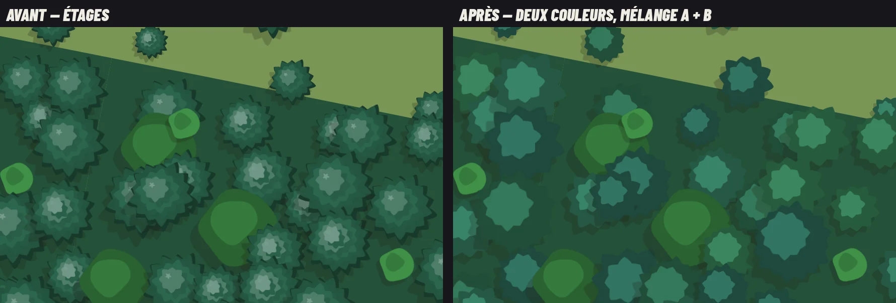
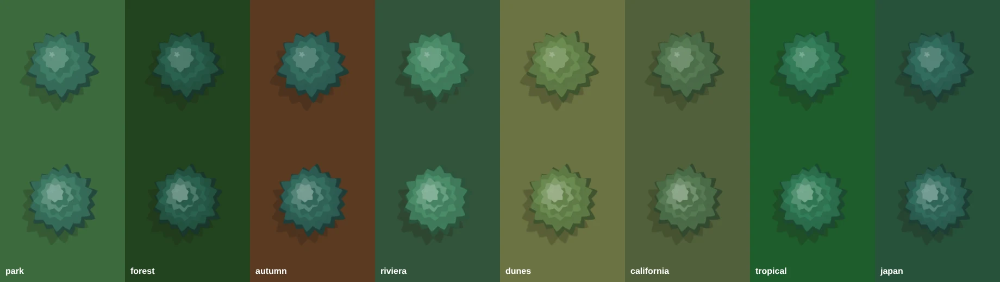
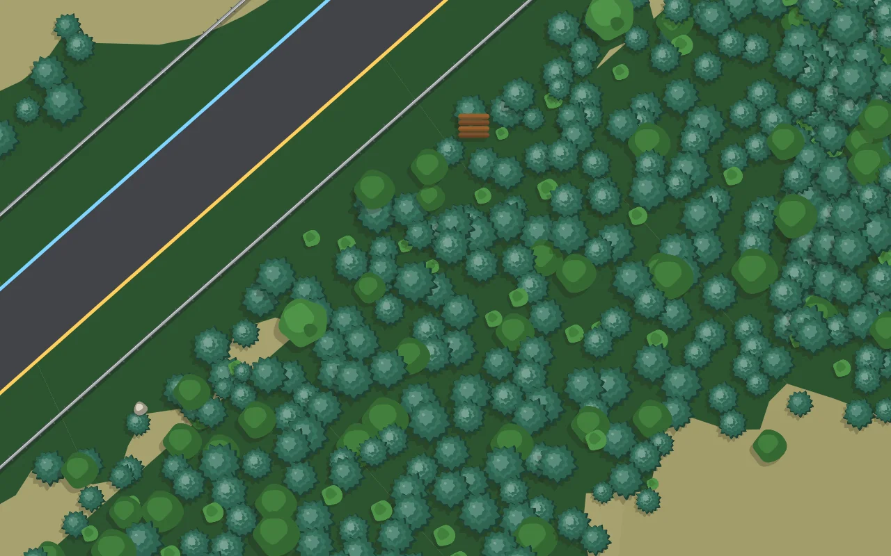

# Conifères — 0.41.4

Les conifères étaient des étoiles à pointes sèches, sombres, avec un point marron au centre : on lisait un chardon, pas un sapin. Ils sont redessinés (`conifere` et `collerette`, `js/props.js`).

- **Un cône vu du dessus** : trois ou quatre étages de branches de plus en plus petits et clairs vers la cime, chacun décalé vers la lumière (en haut à gauche, comme l'ombre portée du décor).
- **Du volume** : chaque étage est peint deux fois, face à l'ombre puis face éclairée, ce qui laisse un croissant sombre en bas à droite de chaque étage.
- **Une silhouette de résineux** : des pointes d'aiguilles nombreuses et peu profondes, de longueur légèrement inégale, au lieu de grandes épines ; plus de tronc visible (on ne le voit pas d'en haut), une petite pointe claire à la cime.
- **Deux variantes** (`pine` et `pine2`, plus élancé) pour casser la répétition des pinèdes ; elles partagent le même réglage de thème (`alias`), donc la proportion de conifères par circuit ne change pas.

Vérification : `decor-banc`, `decor-protections-banc`, `vehicules-banc`, `e2e-barrieres`. Les vues tour de `docs/exports-circuits/` n'ont pas été régénérées : à cette échelle un conifère fait quelques pixels.
