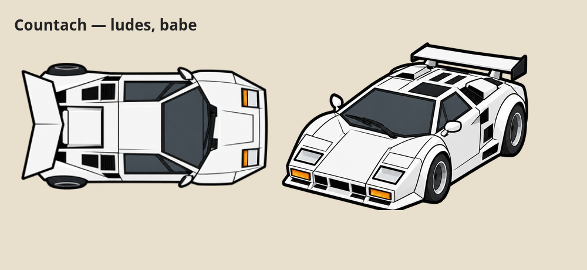

# Countach — ludes, babe

La variante rouge n°41 est remplacée par une carrosserie blanche, sans numéros, appelée exactement « ludes, babe » dans les deux langues du jeu. Les autres livrées sont conservées. L'identifiant interne monaco83 et les chemins existants sont conservés pour que les sélections enregistrées continuent de désigner le même emplacement de livrée.

Dimensions conservées : 395 × 203 pour la course, 420 × 286 pour le paddock. Les deux images sont transparentes. Le moteur et les paramètres physiques ne changent pas.
