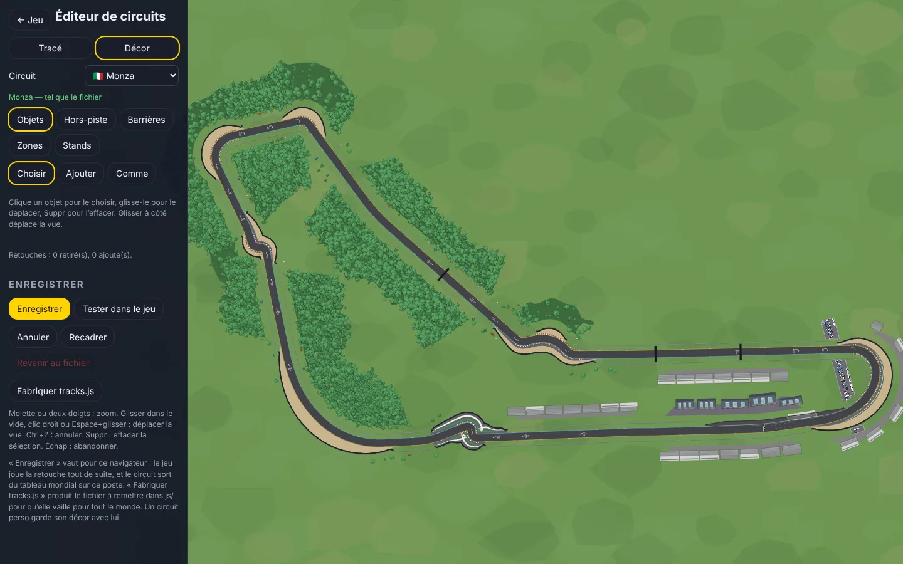
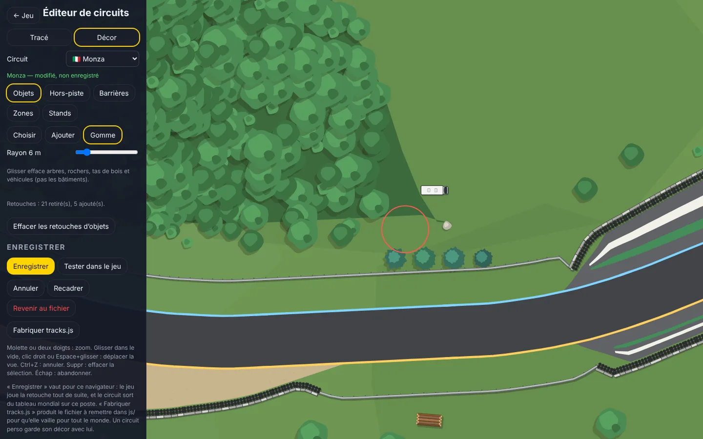
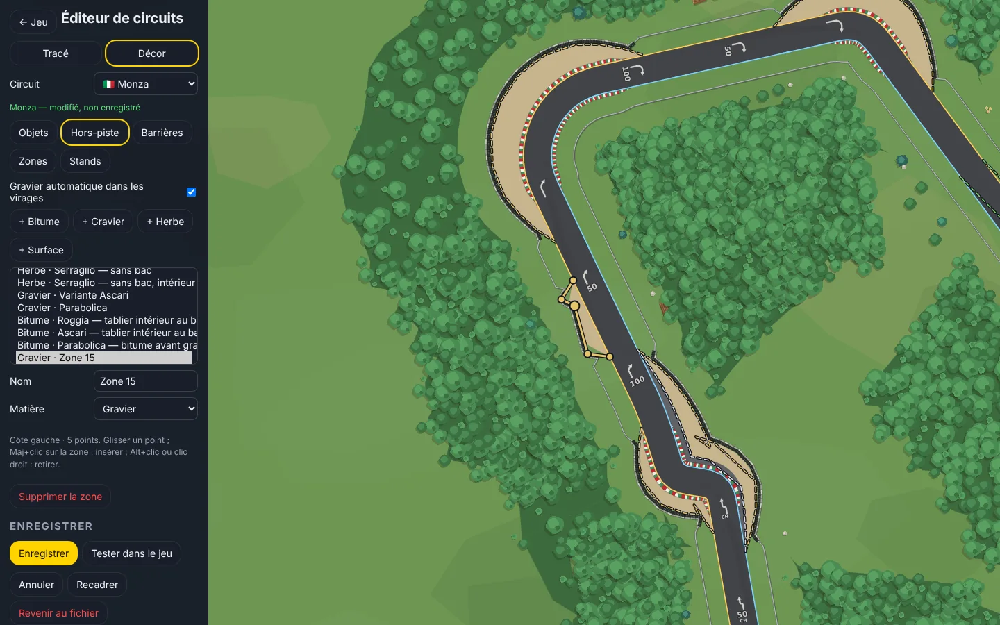
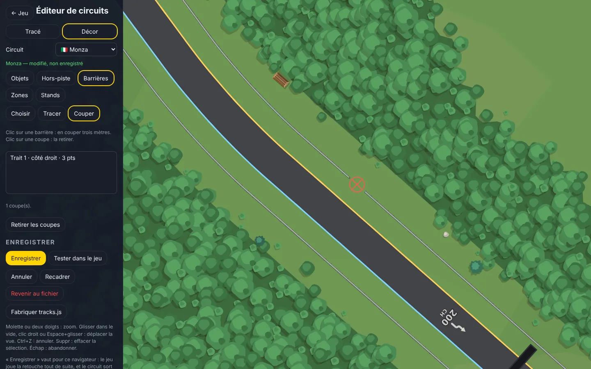
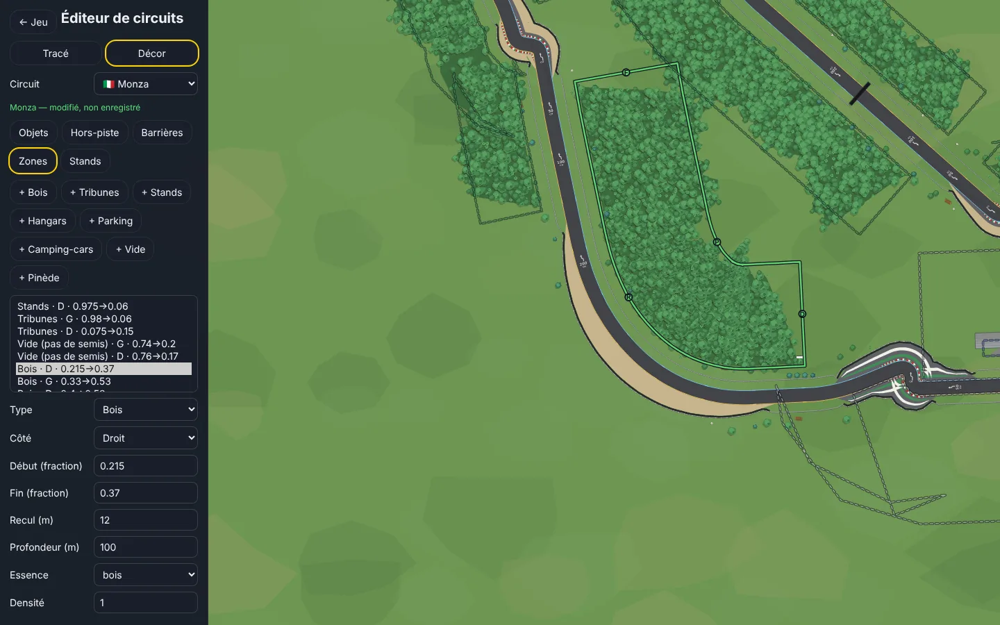
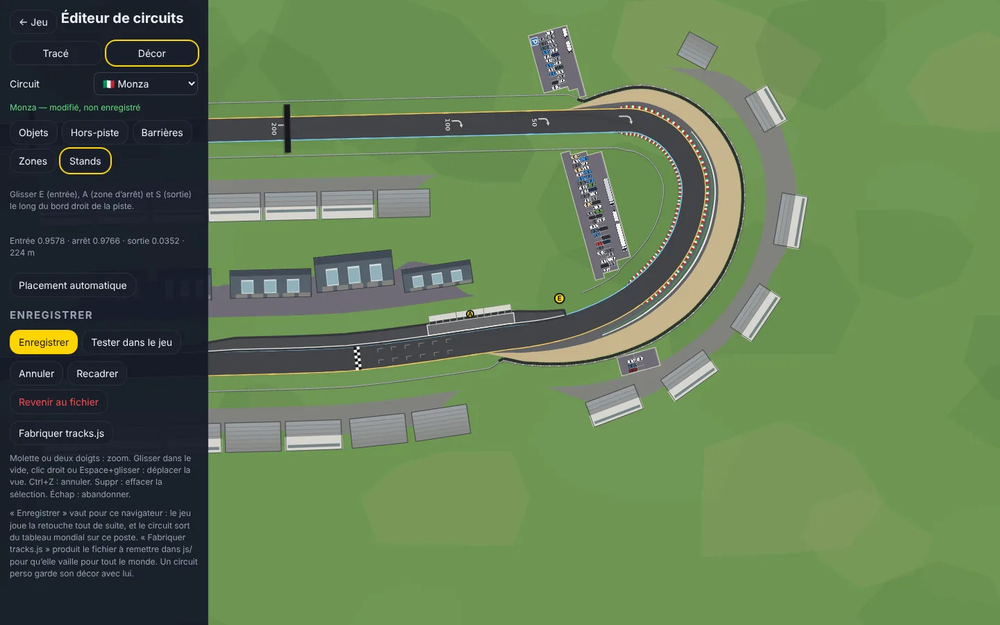
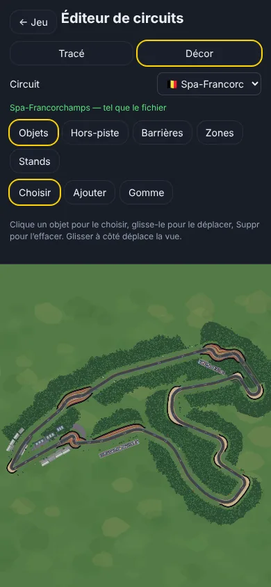

# Éditeur de circuits — mode Décor (0.42.0)

`editor.html`, bouton **Décor** (ou `editor.html?decor=<circuit>`). Tout ce que le jeu dessine autour de la piste se retouche ici, sur les treize circuits du jeu comme sur les circuits perso. Ce qui est affiché est ce que le jeu peindra : c'est son propre moteur de rendu qui dessine, avec la retouche en cours.

## Les cinq outils

**Objets** — chaque arbre (bois et semis), rocher, botte de paille, maison, tas de bois, voiture garée, camping-car, tribune ou hangar.
- *Choisir* : cliquer un objet, le glisser pour le déplacer, Suppr pour l'effacer. La fiche permet de changer son type, sa taille et sa teinte (arbres), son gabarit et sa couleur (véhicules), son angle, ses dimensions (bâtiments).
- *Ajouter* : choisir dans la liste (arbres, décor, quatorze véhicules, hangar, tribune) puis cliquer ; pour les arbres, glisser sème une rangée.
- *Gomme* : glisser efface arbres, rochers, tas et véhicules dans un rayon réglable (pas les bâtiments).

**Hors-piste** — les zones de bitume, de gravier et d'herbe (l'herbe efface le gravier sur son secteur), et les surfaces bitumées dessinées. *+ Bitume / + Gravier / + Herbe* : cliquer le long du bord, Entrée ou double-clic pour terminer. Glisser un point change la largeur ; Maj+clic insère un point, Alt+clic ou clic droit le retire. La case « Gravier automatique » allume ou éteint les bacs déduits des virages.

**Barrières** — *Tracer* : la barrière suit les points cliqués et se raccorde aux barrières calculées. *Choisir* : glisser les points d'un trait, le supprimer. *Couper* : un clic retire trois mètres de barrière, un clic sur la coupe la rend.

**Zones** — les zones d'implantation : bois (feuillus, pinède, taillis), tribunes, stands, hangars, parkings, camping-cars, vide. *+ type*, puis le début et la fin à côté de la piste. Poignées **D**/**F** (début, fin), **P** (profondeur), **R** (recul depuis la barrière) ; la fiche règle aussi le côté, le module, l'essence, la densité.

**Stands** — glisser **E** (entrée), **A** (zone d'arrêt) et **S** (sortie) ; « Placement automatique » rend la main au calcul.

Molette ou deux doigts : zoom. Glisser dans le vide, clic droit ou Espace+glisser : déplacer la vue. Ctrl+Z : annuler. Échap : abandonner un tracé.

## Enregistrer, tester, publier

- **Enregistrer** pose la retouche dans la base du navigateur (rayon `decor`) : le jeu la joue tout de suite sur ce poste. Un circuit ainsi retouché ne propose plus ses temps au tableau mondial, avec un message qui le dit ; « Revenir au fichier » oublie la retouche.
- **Tester dans le jeu** enregistre et ouvre le circuit dans le jeu.
- **Fabriquer tracks.js** relit `js/tracks.js`, y remplace pour chaque circuit retouché les seules clés de décor modifiées, et le rend à télécharger : à remettre dans `js/` pour que la retouche vaille pour tout le monde.
- Un **circuit perso** garde son décor dans sa propre définition ; le mode Tracé le conserve quand on réenregistre les lignes.

## Comment c'est rangé

- Les clés reprises sont celles de `CLES_DECOR` (`js/tracks.js`) : `runoffs`, `annotatedRunoffsOnly`, `implantation`, `barrierPaths`, `barrierCuts`, `asphaltPads`, `pitFrom`, `pitTo`, `pitAt`, et la nouvelle `objets`.
- `objets` tient en deux listes (`appliqueObjets`, `js/props.js`) : `retires`, les positions des objets à enlever (à 40 cm près), et `ajouts`, des objets écrits en entier. Déplacer, c'est retirer puis ajouter. Le décor étant tiré d'une graine, une position désigne toujours le même objet — tant qu'on ne change pas la zone qui l'a semé.
- L'écriture du fichier (`js/fichier-tracks.js`, partagé avec `lignes.html`) remplace une clé de premier niveau dans la définition, sans toucher aux autres ni aux commentaires voisins. Vérifié par un aller-retour sur les treize circuits : réécrire toutes leurs clés de décor redonne exactement les mêmes définitions.

## Ce qui ne s'édite pas ici

Le tracé et la largeur de la piste (mode Tracé pour un circuit perso, `lignes.html` pour les lignes des circuits du jeu), les vibreurs, la mer et les bateaux de Monaco, les ponts, tunnels et passerelles.

Vérification : `tools/e2e-editeur-decor.js` — chaque outil à la souris, annulation, enregistrement relu par le jeu, fichier fabriqué qui s'évalue et ne touche qu'au circuit retouché, circuit perso, téléphone. `e2e-lignes`, `e2e-barrieres`, `e2e-menu` et les bancs du décor passent.

## Combler un îlot dans un dégagement — 0.42.2

Les zones ordinaires sont décrites par une largeur le long de la piste. À l'intérieur des épingles et entre deux virages, ces bandes peuvent laisser des poches d'herbe ; agrandir leur largeur ne suffit pas toujours, car le décalage peut se replier ou être limité par une portion de piste voisine.

Dans **Décor → Hors-piste** :

1. Choisir **Combler : bitume** ou **Combler : gravier**.
2. Cliquer autour du trou, avec au moins trois points. On peut déborder légèrement sur le dégagement existant pour éviter une couture.
3. Terminer avec **Entrée**, un double-clic ou le bouton **Terminer** (également sur téléphone).
4. Déplacer les points si nécessaire, puis **Enregistrer**. La liste permet de sélectionner de nouveau le comblement et de changer sa matière. **Annuler** ou Ctrl+Z défait le geste.

Le contour se ferme directement : il n'est pas rattaché automatiquement à un autre bord de piste. Il reste sous la piste et les vibreurs. Les barrières et les objets ne sont pas déplacés automatiquement. Les modifications enregistrées sont locales au navigateur ; utiliser l'export de l'éditeur pour les reporter dans le fichier du jeu.

Le bitume et le gravier sont reconnus par le moteur de conduite. Si deux surfaces dessinées se recouvrent, la dernière prévaut. Leurs remplissages sont séparés, ce qui évite qu'un contour tracé dans l'autre sens crée un trou par annulation.

Vérifications automatisées : création par clics, matière, annulation, superposition de contours de sens opposés (rendu et physique), sauvegarde locale, export `tracks.js`, chargement dans le jeu et interface mobile.
