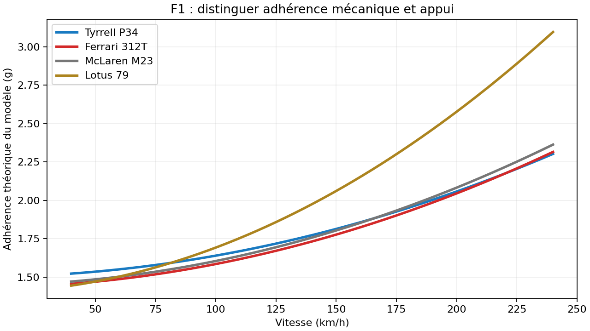

# Comportement des quatre F1 — 0.29.1

Les réglages initiaux favorisaient la Lotus sur tous les circuits, et distinguaient peu la Ferrari de la McLaren. Les nouveaux réglages répartissent les qualités : adhérence mécanique pour la Tyrrell, vitesse de pointe et motricité à doser pour la Ferrari, équilibre pour la McLaren, appui à haute vitesse pour la Lotus.

| Voiture | Caractère recherché | Contrepartie |
| --- | --- | --- |
| Tyrrell P34 | Stable et efficace dans le lent, facile à reprendre aux impulsions | Pointe limitée à 252 km/h théoriques |
| Ferrari 312T | Pointe de 277 km/h, reprises plus vives que le réglage initial, arrière plus mobile | Demande davantage de dosage à la limite |
| McLaren M23 | Bon compromis accélération, adhérence et progressivité | Ni la meilleure pointe, ni le plus d’appui |
| Lotus 79 | L’appui prend l’avantage avec la vitesse | Moins d’adhérence mécanique que la Tyrrell et accélération plus lente |

Ce sont des choix de gameplay inspirés des voitures. La P34 utilise toujours le modèle physique à deux essieux du jeu : ses six roues sont traduites par son caractère d’adhérence, pas par six contacts indépendants. L’appui de la Lotus dépend de la vitesse ; la hauteur de caisse et l’effet de sol réel ne sont pas simulés.

La courbe est calculée avec `gripAt`, sans usure ni aide : elle décrit le modèle du jeu, pas des mesures historiques. Les valeurs de pointe et de 0–100 proviennent des mêmes paramètres que les cadrans du menu et ne sont pas des chronos de circuit.

## Protocole

112 combinaisons avant et après, toutes terminées, et 672 reprises de commande par configuration : quatre F1, Monaco/Spa/Monza/Zandvoort, frein à 75/100/130 %, deux marges d’allure de l’IA (0,95 et 1,05). La M1 et la F40 servent de témoins au frein à 100 %. Chaque essai vise deux tours, avec une limite de 440 secondes, à pas fixe de 1/120 s et graine 42761. Le pilote automatique utilise les aides du joueur ; aucun changement n’est appliqué aux neuf modèles précédents ni aux constantes globales de motricité.

Sur les essais à marge 0,95, trois états de virage sont capturés par niveau de charge de l’arrière. Chaque état est rejoué pendant 1,2 s avec pied levé, gaz tenus, impulsions 60 ms et impulsions 120 ms. Les comparaisons de commandes partent exactement du même état pour une voiture donnée. Les états des différentes voitures ne sont pas identiques : ce protocole mesure leur contrôle, pas une supériorité universelle.

Une passe complémentaire de 48 essais a ajusté Ferrari et Lotus. Une puissance trop élevée pénalisait la Ferrari par saturation de la motricité : le réglage retenu privilégie une puissance utilisable. L’appui de la Lotus est renforcé en conservant une contrepartie dans le lent.

## Résultats sur tours propres

Meilleur tour des deux tours, frein 100 %, marge 0,95. Valeurs du jeu en secondes ; les centièmes n’indiquent pas une précision historique.

| Voiture | Monza avant → après | Spa avant → après |
| --- | --- | --- |
| Tyrrell P34 | 75,14 → 75,23 | 101,20 → 101,11 |
| Ferrari 312T | 76,68 → 75,87 | 105,19 → 103,12 |
| McLaren M23 | 76,33 → 75,68 | 103,93 → 102,24 |
| Lotus 79 | 74,34 → 75,34 | 99,56 → 100,47 |

À Monza, les quatre sont désormais dans un écart de 0,64 s sur ce protocole, contre 2,34 s initialement. La Lotus reste la plus rapide à Spa ; la Tyrrell est la plus rapide à Zandvoort sur le tracé antérieur à l’annotation d’élargissement. Les témoins M1/F40 donnent les mêmes chronos avant/après.

Les fichiers `avant.json` et `apres.json` conservent toutes les combinaisons, y compris sorties, tours invalides et essais au frein fort. Les paramètres résolus sont dans `modeles-avant.json` et `modeles-apres.json`.

## Dosage par impulsions

À forte charge de l’arrière, frein 100 %, moyenne des pics de dérive sur les quatre circuits :

| Voiture | Gaz tenus | Impulsions 60 ms | Impulsions 120 ms |
| --- | --- | --- | --- |
| Tyrrell P34 | 17,6° | 7,4° | 7,7° |
| Ferrari 312T | 20,0° | 10,7° | 10,8° |
| McLaren M23 | 17,3° | 9,1° | 9,1° |
| Lotus 79 | 17,0° | 7,2° | 7,2° |

Les impulsions contiennent le travers en échange de vitesse. Les appuis de 120 ms ralentissent davantage que ceux de 60 ms ; il n’existe pas un rythme gagnant dans toutes les situations. Dans les virages peu chargés, tenir les gaz reste utile. La Ferrari conserve le caractère le plus mobile des quatre à pleine charge.

## Frein et limites

Commencer autour de 75 à 100 % de frein est une bonne base d’essai ; augmenter progressivement selon le circuit et le geste. À 130 %, le transfert vers l’avant peut encore provoquer des sorties, notamment à Spa. Un frein plus fort n’est donc pas automatiquement un meilleur réglage. Aucun réglage sauvegardé par le joueur n’est remplacé.

Monaco reste une limite du pilote automatique : les deux tours de référence sont invalidés aussi sur la M1 et la F40. On ne présente donc pas leurs temps bruts comme des tours propres, ni ce banc comme une preuve que la voiture ne sortira jamais. Les résultats en contre-la-montre, sans trafic ni usure, ne remplacent pas un essai au pouce ; le ressenti reste à valider en jouant.

Les reprises de Suzuka et l’élargissement demandé à Zandvoort sont postérieurs à la comparaison principale. Leur contrôle complémentaire est conservé séparément dans `validation-reprises.json`, pour éviter d’attribuer à la physique un gain provenant du circuit.

Reproduction : `node tools/f1-comportement-banc.js --out=/tmp/f1-mesures.json --workers=3`. Pour les reprises : `--cars=tyrrellp34,ferrari312t,mclarenm23,lotus79 --tracks=zandvoort,suzuka --brakes=1 --margins=.95`.

Validation des reprises : huit essais supplémentaires (quatre F1 × Suzuka/Zandvoort) bouclent les deux tours, sans sortie. Les profils de pilotage de l’IA restent ceux du tracé central existant ; cet essai ne prétend pas exploiter toute la chaussée nouvellement élargie.
