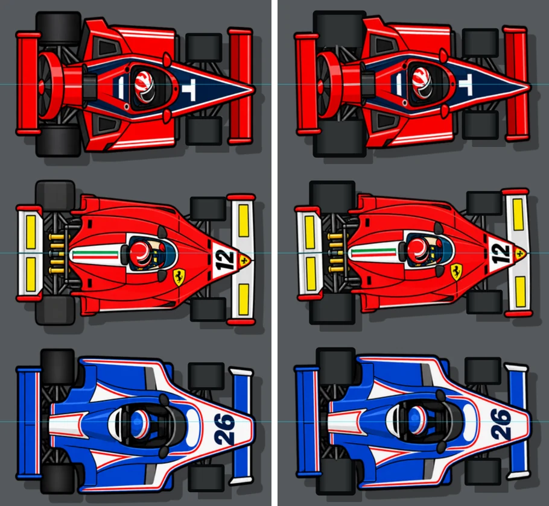
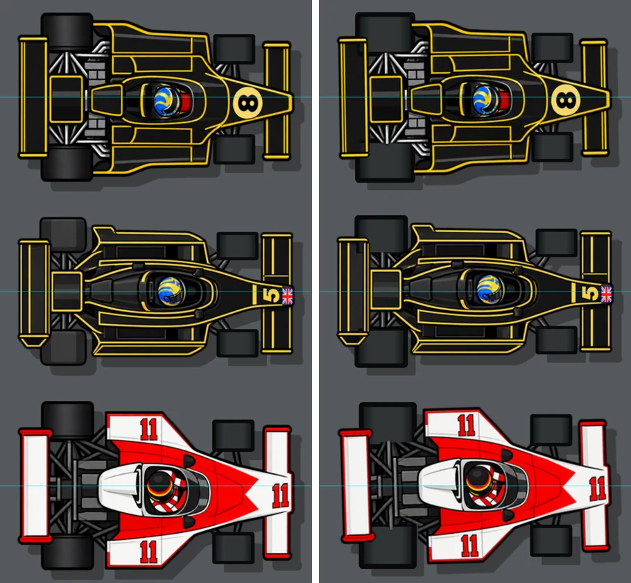
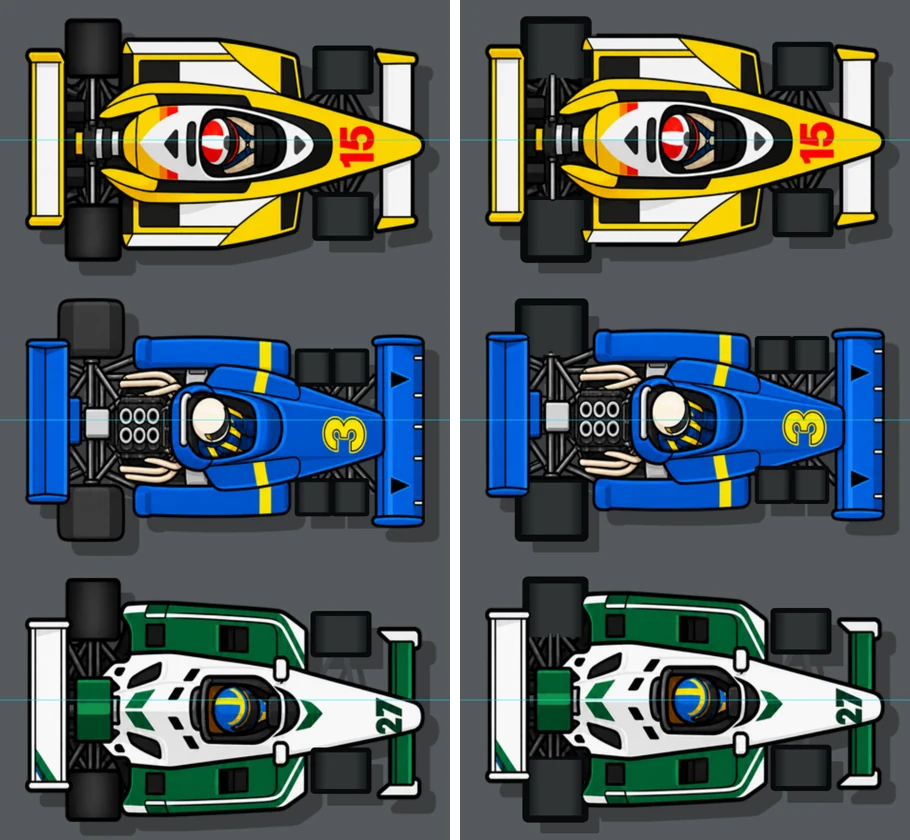

# Les roues des F1, d'aplomb (0.52.71)

> « Sur au moins une F1 les roues arrière ne font pas la même taille et les roues avant ne sont pas
> centrées ! Il faut que tu révises tous les modèles F1 » — Bruno

## Ce qui n'allait pas

Les neuf F1 ont la même illustration vue de dessus (`sprites/top/<id>.png`, avant vers la droite),
avec les roues arrière peintes dedans et les roues avant posées par le jeu sur les moyeux dessinés
(`registerWheelSprite`, js/cars.js). Mesures sur les images d'origine (axe : la hauteur qui superpose
le mieux la silhouette centrale à son reflet ; « haut » est le côté gauche de la voiture) :

| voiture | carrosserie sous le milieu du cadre | milieu des roues avant / axe | bord intérieur des roues arrière, haut / bas | hauteur des roues arrière, haut / bas |
|---|---|---|---|---|
| Sixpence Hexa | +7.0 px | +6.1 px | 70.0 / 62.0 px | 65 / 59 px |
| Purosangue Dodici T | +5.5 px | +5.4 px | 75.5 / 68.5 px | 58 / 53 px |
| McHaggis Arrow 23 | +9.0 px | +0.2 px | 73.0 / 56.0 px | 64 / 63 px |
| Bumblebee Ground 79 | +3.0 px | +1.9 px | 58.0 / 56.0 px | 58 / 54 px |
| Bumblebee Wedge 72 | +2.5 px | +0.8 px | 67.5 / 66.5 px | 63 / 59 px |
| Boomerang Fan 46 | +6.0 px | +2.7 px | 68.0 / 59.0 px | 66 / 63 px |
| Windsor 07 | +9.5 px | -6.9 px | 65.5 / 59.5 px | 72 / 59 px |
| Le Coq Bleu 11 | +9.5 px | +0.2 px | 68.5 / 58.5 px | 69 / 59 px |
| Somua Turbo 10 | +3.5 px | -0.2 px | 64.5 / 59.5 px | 67 / 65 px |

Les roues arrière, elles, sont restées à peu près centrées sur le cadre : par rapport à la carrosserie,
celle du haut sort plus loin que celle du bas (jusqu'à 17 px sur l'Arrow 23), et elle touche souvent le
bord de l'image, qui la rogne. Les roues avant de la Windsor 07, de la Dodici T et de la Sixpence Hexa
étaient de travers de 5 à 7 px.

## Ce qui change

`python3 tools/f1-roues.py`, pour chaque F1, en repartant des images d'origine
(`art-src/voitures/f1-roues/`) :

1. les deux roues arrière sont ôtées de l'image : seulement leurs pixels de pneu (gris très sombre et
   sans couleur, contour et reflet compris), jamais ce qui borde une pièce de couleur — le contour d'un
   aileron posé sur le pneu reste à l'aileron ;
2. l'image est décalée d'un nombre entier de pixels pour que l'axe de la carrosserie tombe au milieu du
   cadre : la voiture est centrée sur sa position, et son ombre avec elle. Les dimensions des images ne
   changent pas ;
3. le jeu dessine les quatre roues (`drawTires`, js/carart.js), symétriques autour de l'axe :
   - arrière : la même taille des deux côtés (la moyenne des deux mesurées), au plus petit des deux
     écarts intérieurs pour que la roue rejoigne toujours la suspension dessinée ; elles passent sous
     la carrosserie, comme avant ;
   - avant : à l'écart moyen des deux moyeux, au-dessus de la suspension, comme avant.

Les roues arrière ont donc désormais le dessin des roues avant (celui de la 0.52.40, « Pneus vus à
90° »), au lieu de celui de l'illustration.

En passant, l'ombre : elle était découpée hors des pneus par un seul « pair-impair » sur tous les pneus
à la fois, qui la rouvrait là où deux pneus se chevauchent — les deux roues avant d'un même côté de la
Sixpence Hexa, en braquant. Elle est maintenant découpée pneu par pneu (`drawCarShadow`).

## Avant / après

Rendu par le moteur du jeu (`drawCarModel`), roues droites ; la ligne bleue est le centre de la voiture.

## Contrôles

- `tools/e2e-cartoon.js` : 58 livrées, braquage dans les deux sens, une seule couche d'ombre sous les
  pneus, roues F1 au-dessus de la suspension, nombre de roues directrices.
- `gabarits.json` : les mesures et les gabarits calculés, voiture par voiture.
