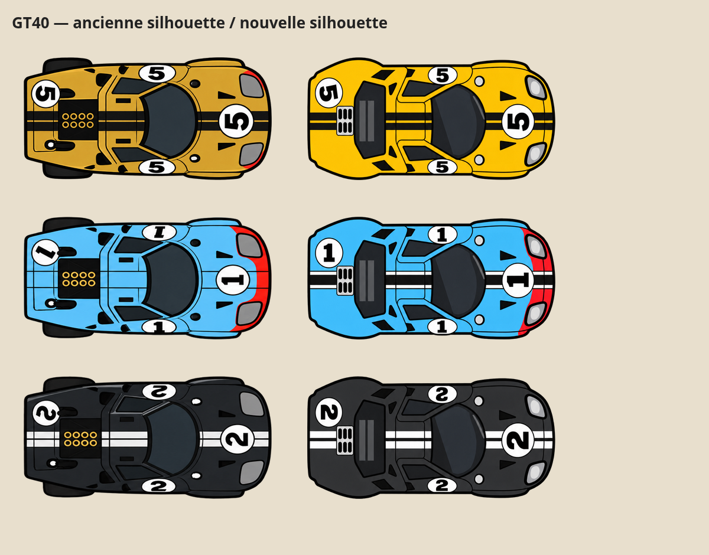

# GT40 — silhouette et dessin simplifié

Les trois sprites de course reprennent la silhouette de la référence fournie : arrière large intégré à la carrosserie, lunette moteur et petite grille arrière, pneus arrière couverts. Le dessin final est simplifié après retour utilisateur : contours épais, moteur représenté par deux barres, vitrages sans détails mécaniques. Livrées conservées : dorée n°5, bleue à nez rouge n°1, noire n°2.

Chaque PNG garde exactement 420 × 208 pixels, avec fond transparent. Les roues avant mobiles sont conservées sous les ailes avec un placement spécifique à la GT40 ; un test du rendu réel vérifie qu'elles ne dépassent pas de la silhouette, roues droites et braquées à ±0,65 radian, pour les trois livrées. Dimensions physiques et comportement des voitures inchangés.

Le comparatif montre les anciens PNG à gauche et le rendu réel avec les nouveaux sprites et roues mobiles à droite. Les illustrations du paddock ne sont pas remplacées par ces vues de dessus.

Validation : `tools/e2e-gt40-silhouette.js` ; test des 57 livrées de `tools/e2e-cartoon.js`. La GT40 n'est plus tenue d'exposer visuellement le braquage à travers une carrosserie fermée ; son contrôle spécifique vérifie la couverture des roues.
