# Interfaces illustrées — 0.39.0

Captures réelles de la branche hybrid. Cette révision reprend plus fidèlement [la maquette approuvée](../propositions-interface/02-paddock.png).

## Retouches de la 0.39 — au plus près de la maquette

Les écarts relevés par Bruno sur les trois planches de [propositions-interface](../propositions-interface/README.md) :

- **Une seule police.** Tout le texte des menus et du HUD passe en Barlow Condensed Black Italic :
  retour, livrées, chiffres de la voiture, réglages, résumé du circuit, mais aussi, en course, le
  chrono, le meilleur tour, le classement, la vitesse, les libellés du curseur et les messages. Les
  chiffres du chrono et de la vitesse sont dessinés à chasse fixe : la police a des chiffres
  proportionnels, et un chrono qui défile tremblait à chaque centième.
- **Le paddock PC ne défile plus.** L'écran est une grille titre / deux colonnes / barre du bas, à la
  hauteur exacte de la fenêtre ; ce sont les images (voiture, affiche) qui cèdent la place. Les
  réglages ont quitté leur bloc du bas de page pour des **pastilles** dans la barre :
  « DIFFICULTÉ : NORMAL », « TOURS : 5 », « USURE : COUPÉ », « FREINAGE », « RÉGLER », et sur PC
  « COMMANDE ». Une pastille passe à la valeur suivante à chaque appui — ce sont les actions
  `pickDiff`, `pickLaps` et `pickWear` d'avant, avec la valeur suivante pour identifiant. Vérifié
  sans défilement à 1440 × 900 et 1366 × 768, en course et en contre-la-montre (`e2e-menu`). En
  contre-la-montre, les records se rangent sous l'affiche du circuit, avec leur propre défilement.
- **Sur téléphone, le paddock n'est plus le fond de tout l'écran**, seulement celui de la voiture :
  le reste se pose sur le papier crème. Les réglages défilent avec la page ; seul « EN PISTE ! »
  reste collé en bas.
- **Les damiers** : dans la barre de titre, entre le retour et la bande rouge du titre, et collé à
  « EN PISTE ! » (le bouton s'appelait « Départ ! »), sur PC comme sur téléphone. Sur l'accueil,
  chaque bandeau se termine par son damier, et le pied lit « PILOTE : BRUNO ».
- **Le tour en course** : « TOUR 3/5 » dans la police de la position, le numéro en grand, comme sur
  la maquette ; le classement se range dessous.
- Les chiffres de la voiture suivent la maquette : vitesse max., 0-100, freinage, adhérence et
  pilotage, chacun avec son libellé. L'affiche du circuit annonce le nombre de tours de la course.

Pour la manette, **chaque liste de la barre est un groupe à elle** : sur une liste, la croix
gauche/droite change la valeur, si bien que deux listes côte à côte dans un même groupe rendaient la
seconde inaccessible sans souris. RB/LB passe d'une pastille à l'autre (`e2e-manette`).

## Paddock et affiche de circuit

Le paddock occupe la scène PC, avec la voiture en grand et le circuit présenté sur une affiche. Les tracés exacts du jeu sont noirs, détourés de beige et centrés sur les illustrations, sans rectangle derrière. Le drapeau est affiché à côté du nom. La typographie condensée est fournie avec le jeu et les boutons ont des bords obliques.

Les vignettes de livrées sont maintenant directement sélectionnables. Les rails de modèles et de circuits, les réglages et les commandes de départ restent fonctionnels au clavier, au tactile et à la manette. Les performances affichées proviennent des données du jeu ; elles ne recopient pas les valeurs fictives de la maquette.

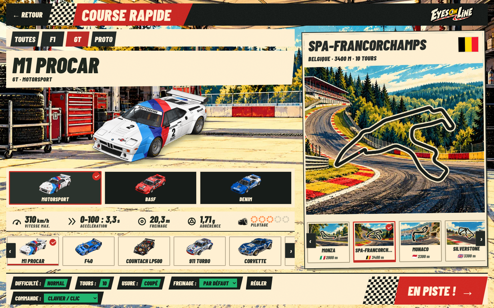

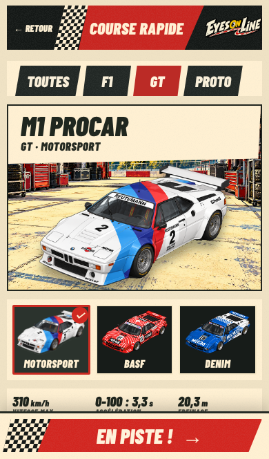

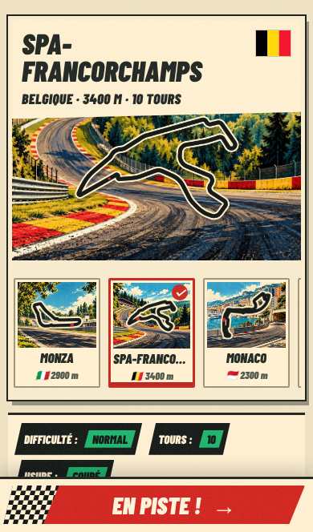

## Accueil

Les pictogrammes de pneus, chronomètre, casques, réglages et pilote sont des images générées sur fond transparent. Les boutons colorés et le bandeau noir réglages/pilote reprennent les silhouettes obliques et le grain imprimé de la proposition.

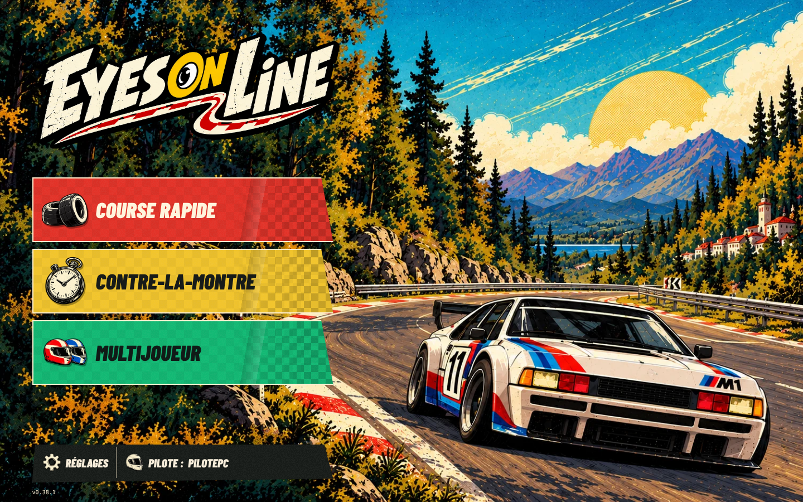

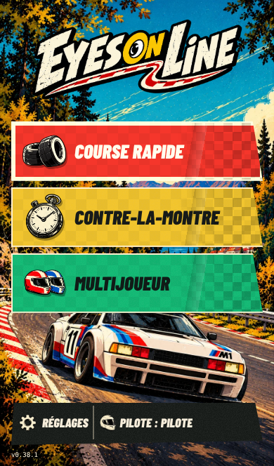

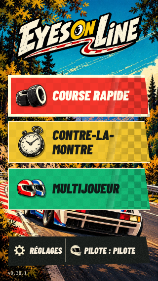

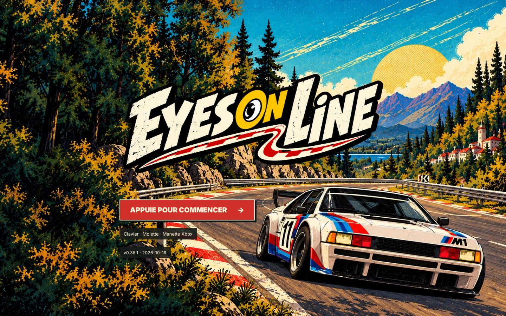

## En course

- Position `P 7/10` sur panneau beige oblique.
- Pause noire à droite ; compteur de tours juste dessous.
- Chrono courant noir au centre, meilleur tour sur beige.
- Vitesse sur fond noir semi-transparent.
- Classement : pilote sur beige et autres voitures sur noir en PC ; lignes noires compactes sur mobile.
- Minicarte en trait beige sans fond. Les drapeaux, les gros chiffres au sol, les flèches et les bordures jaunes et bleues restent présents.

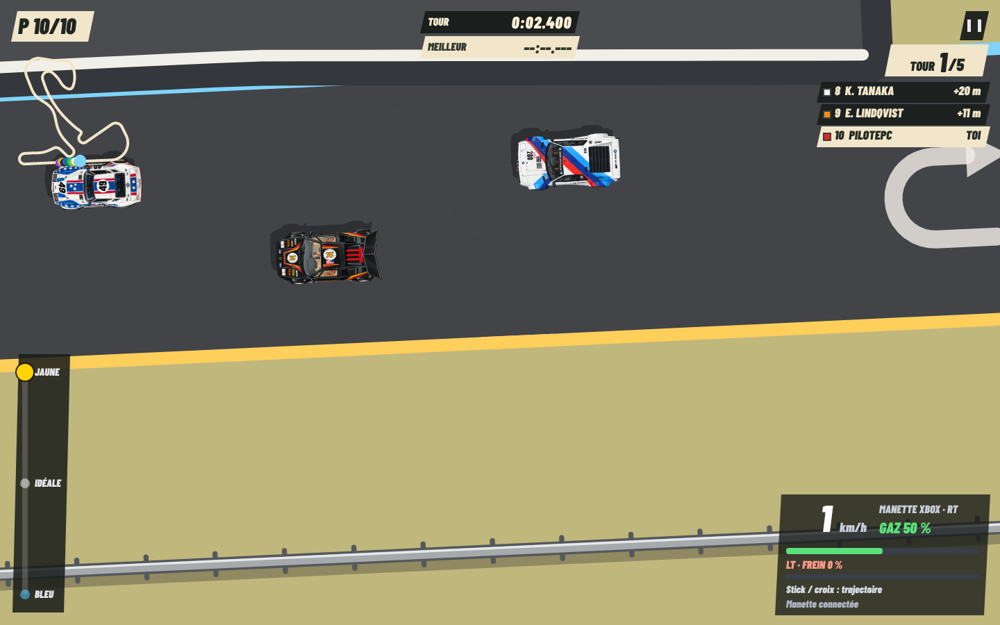

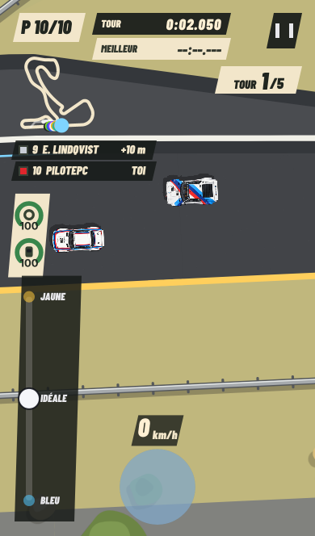

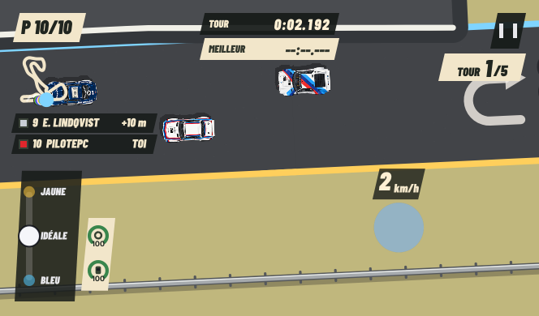

Les écarts sont en mètres tant qu’aucun meilleur tour n’est disponible, puis estimés en secondes (≈). La physique et les commandes de conduite sont conservées.

## Autres modes

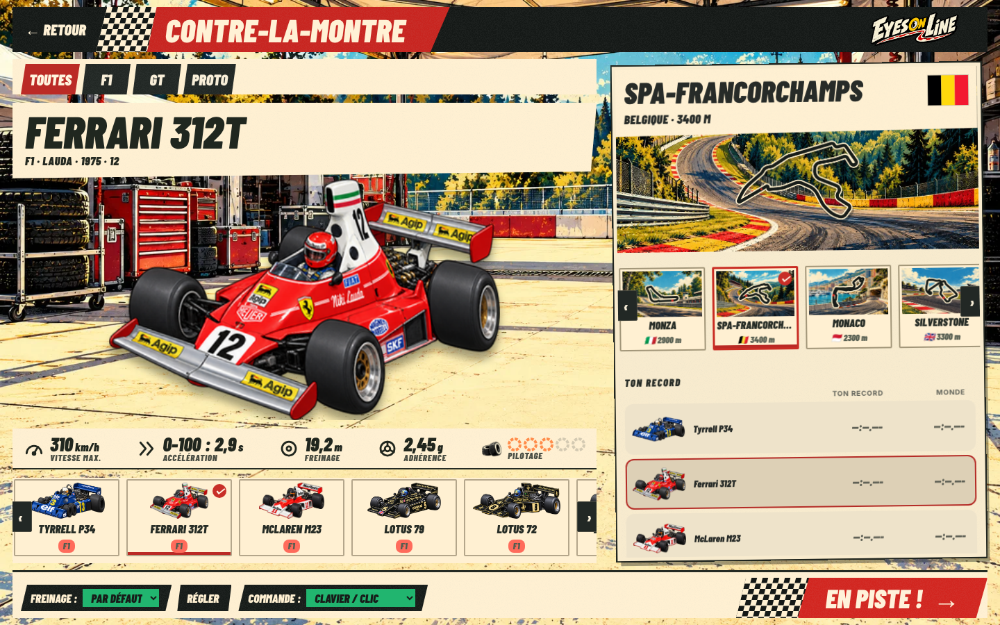

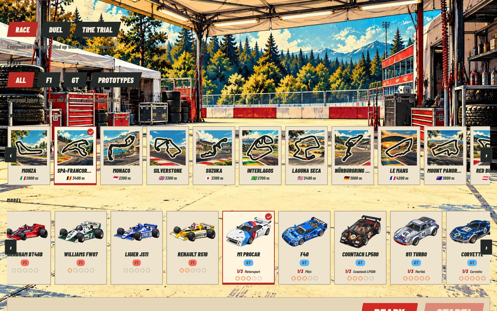

## Vérifications

- `tools/e2e-menu.js` : cinq formats, FR/EN, visibilité réglages/pilote, alignement stable, absence de débordement, chargement des fonds, de la police et des drapeaux, centrage de la carte, sélection des trois livrées M1, salon à deux joueurs.
- `tools/e2e-pc.js` : clavier, souris, molette, RT, pause/reprise, déconnexion, sauvegarde, HUD sans chevauchement et cible pause à droite ; portrait/paysage mobile/tablette et retour aux menus en colonne.
- `tools/e2e-manette.js` : navigation, rails, livrées, réglages, RT/LT, retour B, saisie du pseudo et reconnexion.
- `tools/e2e-flags.js` : pixels des drapeaux, contre-la-montre annulé, zones jaunes, synchronisation multi et vues spectateur.

Tous ces parcours Chromium passent sans erreur JavaScript. Manettes et appareils mobiles sont simulés ; un essai sur matériel réel reste complémentaire.

## Assets et licences

Illustrations de menu : génération d’images, versions WebP dans `art/interface/`. Les anciens pictogrammes SVG simplifiés ont été remplacés.

Police **Barlow Condensed Black Italic**, Jeremy Tribby, SIL Open Font License : [licence](../../art/interface/fonts/OFL.txt), [source](https://github.com/google/fonts/tree/main/ofl/barlowcondensed).

Drapeaux **flag-icons**, licence MIT : [licence](../../art/interface/flags/LICENSE), [source](https://github.com/lipis/flag-icons).
