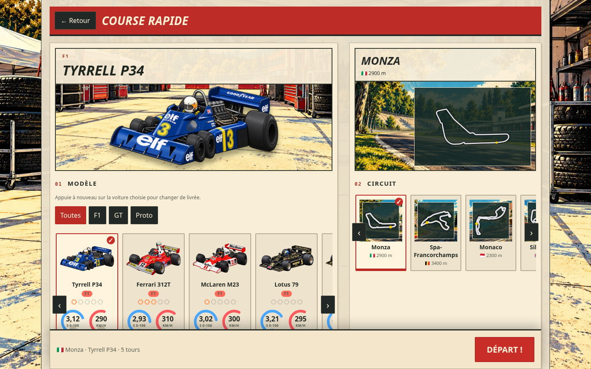
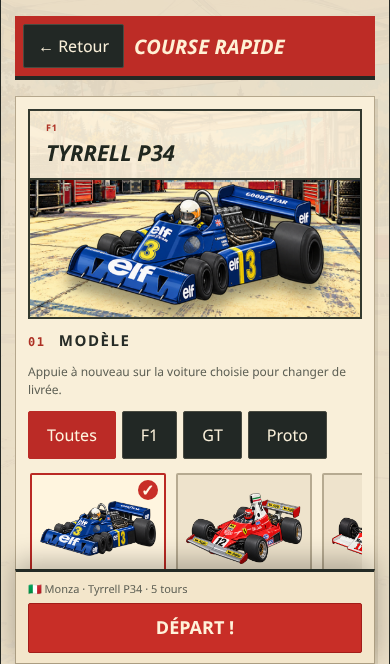

# Interfaces intégrées — 0.38.0

Captures réelles du jeu, après intégration des [propositions visuelles](../propositions-interface/README.md). Branche hybrid.

L’accueil utilise des décors distincts pour PC et mobile, un logo transparent et trois boutons HTML aux dimensions stables. Réglages et pilote restent visibles sur téléphone. Les textes sont traduisibles et les boutons accessibles au clavier et à la manette.

Les sélections course rapide, contre-la-montre et multijoueur utilisent le paddock, les illustrations de voitures existantes et les 13 fonds de circuits. Les cartes sont dessinées à partir des données du jeu, séparément des illustrations. Les circuits personnalisés gardent un fond neutre. Sur téléphone, chaque aperçu précède sa liste de choix ; le départ reste accessible en bas.

En course, les informations sont posées sur des panneaux beiges et les commandes sur des fonds noirs. Le classement PC conserve le joueur et ses voisins. Les écarts sont en mètres tant qu’aucun meilleur tour n’est disponible, puis estimés en secondes (≈) à partir de la distance et du meilleur tour. La physique et les marquages au sol sont conservés.

## Accueil et titre

## Sélections

## Course

## Vérifications

- `tools/e2e-menu.js` : cinq formats, alignement stable, réglages et pilote visibles, fonds de circuits accessibles, sélection et défilement conservés, FR/EN, salon à deux joueurs.
- `tools/e2e-pc.js` : clavier, clic, molette, RT, pause/reprise, déconnexion et sauvegarde ; mobile/tablette en paysage pendant la course et retour aux menus portrait.
- `tools/e2e-manette.js` : priorité à la manette, navigation, rails, livrées, réglages, RT/LT, retour B, saisie du pseudo et reconnexion.
- Aucun échec ni erreur JavaScript dans ces parcours Chromium. Les manettes sont simulées via la Gamepad API ; ceci ne remplace pas un essai sur un iPhone ou une manette physique.

Les décors de menu sont des fichiers WebP optimisés ; aucun PNG de maquette n’est chargé par le jeu. La version et les clés de cache sont passées à 0.38.0.
