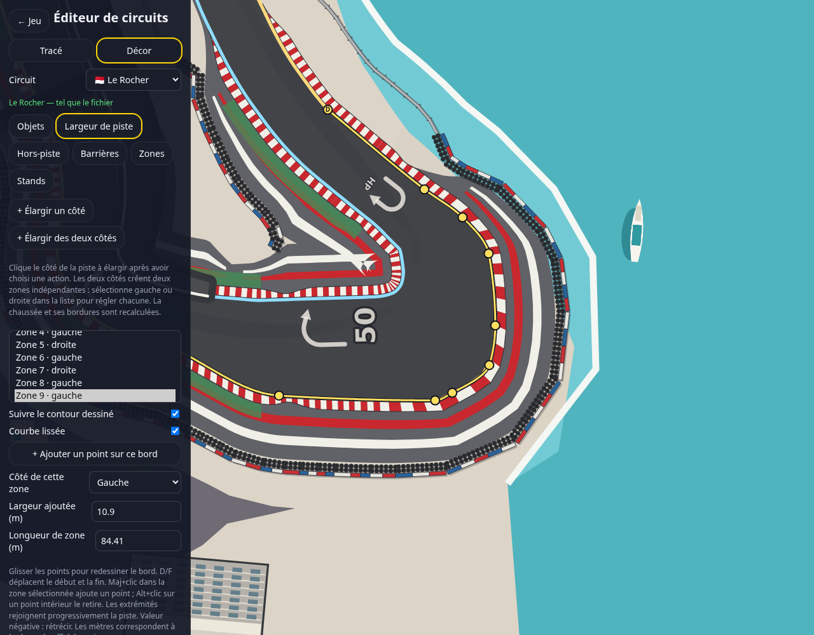

# Courbes des bords de Monaco

Le fichier utilisateur `tracks (7).js` contient neuf profils pour Monaco. Le dernier est un contour de dix points sur le côté +1 (extérieur de l'épingle, fractions 0,8619–0,8986). La capture utilisateur montrait une déformation sur le côté intérieur : ce dessin exact n'est pas présent dans ce fichier. L'application du profil sur le côté opposé reproduit une boucle et des croisements.

Dans Largeur de piste, « Courbe lissée » construit une interpolation cubique continue qui passe par les points, sans dépasser leurs coordonnées sur chaque intervalle. La prévisualisation et le calcul de chaussée utilisent la même courbe. Le bouton d'ajout de points reste disponible. Les données d'origine sont conservées : le lissage s'applique à l'affichage et à la construction, sans supprimer de poignées.

Les anciennes versions remplaçaient les stations non résolues par une largeur interpolée, mélangeant deux géométries. Désormais, un contour qui se croise, un bord reconstruit qui se croise ou une station sans intersection invalide toute cette retouche : la chaussée reste celle précédant cette zone, le contour de contrôle devient rouge et l'éditeur explique le problème. Les autres retouches sont conservées. Depuis 0.52.29, l'axe central se recentre entre les deux bords dessinés (voir « Redessiner le tracé d'un virage » dans le README) : un contour peut passer de l'autre côté de l'axe d'origine. Le contour fourni est suivi à 17 cm au plus, au coin vif ; la variante intérieure qui boucle reste refusée, la chaussée ne pouvant pas la suivre à 1,5 m près.

Validation : fixture reprenant les neuf profils fournis, 84 stations sur le contour final, écart maximal inférieur à un millimètre entre bord reconstruit et courbe, aucune station manquante. La variante intérieure qui boucle est refusée et laisse exactement les largeurs de piste précédentes. Tests de sauvegarde, export, annulation, glissement et insertion conservés.

Les autres changements du fichier utilisateur (décor, revêtements) n'ont pas été importés dans les circuits livrés. La capture est une prévisualisation du profil fourni sur la définition actuelle de Monaco.
