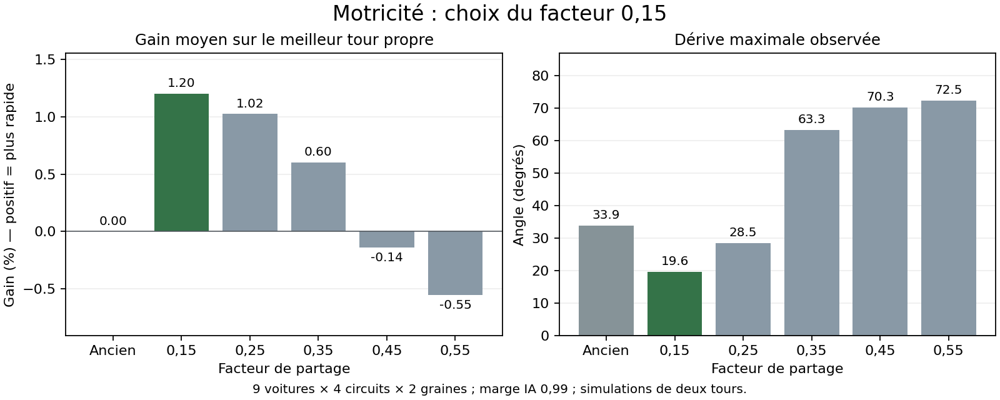

# Motricité progressive — décision et mesures

Le facteur **0,15** est retenu pour `claude/gameboy` et `claude/hybrid-racing-game-2d-jkk7q0`. Il supprime la coupure complète de poussée à la limite d'adhérence et le second abattement moteur en virage. La poussée restante se paie par une réduction progressive de la tenue latérale arrière. Relâcher les gaz rend immédiatement cette capacité aux pneus ; le freinage existant monte toujours sur 100 ms.

Ce compromis reste volontairement prudent : il ne transmet pas toute la puissance demandée lorsque les pneus sont saturés. Le facteur représente le poids du nouveau partage dans le modèle, pas un pourcentage de pédale ni une probabilité de dérapage.

## Protocole et référence

Référence immuable : `6b2d2024c9dc8f6964a5a3666027317daf256146`. Dans les fichiers, `current` désigne cette ancienne physique, `live` le code livré. Le champ `revision` indique le HEAD au moment de l'exécution, pas un commit contenant les modifications alors non commitées.

- Neuf voitures : M1 Procar, F40, Countach, 930, GT40, 935, Corvette, 787B et CSL.
- Quatre circuits : Monaco, Spa, Monza et Zandvoort.
- Six variantes : ancienne physique puis facteurs 0,15 / 0,25 / 0,35 / 0,45 / 0,55.
- 864 essais solo de deux tours : deux graines (42761 et 20261014), deux marges de pilotage automatique (0,95 et 0,99). Tous terminés.
- 108 essais de deux tours en peloton de huit voitures, marge 0,99, graine 42761, ancienne physique / 0,15 / 0,25.
- 1 080 reprises de 1,2 s depuis les mêmes 36 états de virage : gaz constants, relâchement et alternances 50 / 100 / 150 ms. Les trois alternances ont exactement 50 % de temps enfoncé.
- 72 essais supplémentaires comparent le prototype 0,15 et le code livré : égalité exacte des résultats sur les 36 couples voiture/circuit (chrono, sorties, dérive maximale, poussée conservée et temps hors piste).

L'IA choisit les gaz en fonction de l'état courant : deux facteurs ne reçoivent donc pas exactement la même séquence sur un tour. Les reprises courtes complètent cette comparaison avec des états initiaux identiques. Ce sont des simulations déterministes, pas une mesure du ressenti sur un iPhone réel.

## Résultats solo

Gain moyen sur le meilleur tour propre de chaque essai, relativement à la référence appariée. Un gain positif signifie un tour plus rapide. Dérive = angle entre l'orientation et la vitesse de la voiture ; le maximum inclut les événements brefs.

| Facteur | Gain à 0,95 | Dérive max à 0,95 | Gain à 0,99 | Dérive max à 0,99 | Essais > 45° à 0,99 | Sorties à 0,99 |
| --- | ---: | ---: | ---: | ---: | ---: | ---: |
| Ancien | +0.00 % | 30.1° | +0.00 % | 33.9° | 0 | 0 |
| 0,15 | +0.94 % | 20.7° | +1.20 % | 19.6° | 0 | 0 |
| 0,25 | +0.81 % | 25.5° | +1.02 % | 28.5° | 0 | 0 |
| 0,35 | +0.63 % | 55.7° | +0.60 % | 63.3° | 9 | 0 |
| 0,45 | +0.15 % | 69.5° | -0.14 % | 70.3° | 16 | 0 |
| 0,55 | -0.50 % | 71.1° | -0.55 % | 72.5° | 18 | 1 |

À la marge 0,95, les six variantes n'ont aucune sortie. La référence passe 15,47 % du temps d'accélération en virage avec moins de 1 % de la poussée demandée ; cette proportion tombe à zéro avec les nouveaux facteurs. Cela ne garantit pas une accélération nette positive : traînée, freinage et glissement peuvent encore ralentir le châssis.



### Gain du facteur 0,15 par voiture et circuit

Moyenne des deux graines à marge 0,95, en pourcentage du meilleur tour propre de référence.

| Voiture | Monaco | Spa | Monza | Zandvoort |
| --- | ---: | ---: | ---: | ---: |
| M1 Procar | +0.87 % | +0.42 % | +0.50 % | +2.37 % |
| F40 | +0.79 % | +0.29 % | +0.22 % | +2.50 % |
| Countach | +0.71 % | +0.45 % | +0.22 % | +2.50 % |
| 930 | +1.35 % | +0.59 % | +0.44 % | +2.10 % |
| GT40 | +0.97 % | +0.56 % | +0.32 % | +1.39 % |
| 935 | +1.51 % | +0.25 % | +0.44 % | +1.56 % |
| Corvette | +1.26 % | +0.36 % | +0.57 % | +1.46 % |
| 787B | +0.71 % | +0.51 % | +0.55 % | +2.17 % |
| CSL | +0.94 % | +0.43 % | +0.33 % | +1.32 % |

## Peloton et pulsations

| Facteur | Sorties joueur, 36 essais | Sorties des 7 adversaires | Essais sans tour propre |
| --- | ---: | ---: | ---: |
| Ancien | 23 | 20 | 0 |
| 0.15 | 9 | 19 | 1 |
| 0.25 | 18 | 23 | 3 |

Le 0,15 conserve un cas difficile : CSL à Zandvoort, deux sorties et aucun tour propre. Le 0,25 en a trois : 930 à Zandvoort (deux sorties), 935 à Zandvoort (deux), Corvette à Zandvoort (trois). La première préférence pour 0,25 a donc été révisée après le peloton.

Les chiffres ci-dessous portent sur les trois alternances uniquement, soit 108 reprises par facteur. L'impulsion est l'intégrale de la poussée moteur pendant les premières 50 ms, en m/s ; ce n'est pas le gain net de vitesse.

| Facteur | Dérive maximale | Impulsion moyenne 50 ms | Reprises avec dérive finale > initiale + 2° |
| --- | ---: | ---: | ---: |
| Ancien | 43.6° | 0.049 m/s | 12 |
| 0.15 | 22.4° | 0.116 m/s | 6 |
| 0.25 | 29.3° | 0.136 m/s | 9 |
| 0.35 | 37.3° | 0.157 m/s | 9 |
| 0.45 | 45.4° | 0.178 m/s | 12 |
| 0.55 | 52.0° | 0.199 m/s | 18 |

Aucune sortie sur ces reprises pulsées. Les facteurs forts rendent davantage de poussée mais dégradent la stabilité. Le 0,15 offre le meilleur compromis parmi les variantes mesurées, sans prétendre constituer un optimum universel.

## Commandes et retours de patinage

Les fronts d'appui sont conservés entre les images en solo et pour le joueur hôte : une pression de 50 ms entre deux images espacées de 66 ms n'est plus perdue. Le banc vérifie les alternances 50 / 100 / 150 ms à 15 / 30 / 60 images/s et la remise à zéro en pause. Les invités multijoueurs transmettent encore le dernier état du bouton par le réseau ; leur conservation des impulsions demanderait une évolution du protocole d'entrée.

Le son des pneus, les deux traces arrière et la fumée suivent progressivement la poussée non transmise et la dérive. Un filtre cosmétique de 35 ms à l'attaque et 80 ms au relâchement évite les coupures sèches ; il n'agit jamais sur les forces ni sur la commande. Le régime sonore reçoit un supplément borné à 12 %, 4 m/s et à la réserve disponible avant le limiteur. Les rapports restent choisis sur la vitesse du châssis. Le démarrage conserve son embrayage sonore existant.

Ce patinage est un indice issu du partage de poussée, pas une simulation de vitesse angulaire des roues. Trois bits libres du paquet de course transportent l'effet vers les invités sans agrandir le paquet. Les anciennes versions ignorent ces bits.

Un test navigateur injecte également un appui clavier et tactile de 50 ms entre deux images et vérifie sa réception par les sous-pas physiques réels.

Les tests vérifient les neuf moteurs, l'indépendance physique des effets, l'extinction, le codage réseau, la progression du volume réellement rendu par Web Audio et des traces dessinées. Ils vérifient aussi l'absence d'effets de patinage dans les stands, hors piste et avant le départ.

## Spa Game Boy

Sur la branche `claude/gameboy` uniquement, la planche ajoutée par Bruno dans `27b7ca468de480d48b812b0cb90fc2b08e2172d0` est utilisée directement : [PNG original](https://github.com/Brunodrapi/Slot_car_racing/blob/27b7ca468de480d48b812b0cb90fc2b08e2172d0/sprites/258d3eed-5c3d-4689-88a3-8a875d471673.png). Elle remplace les familles de végétation, rochers, bois, barrières et pneus sur Spa Game Boy, avec des textures de bitume et gravier. La géométrie du circuit est conservée.

Le damier est peint dans le RGB de la source : le chargeur rend son fond neutre transparent et encode les quatre tons avant le filtre général, une seule fois au chargement. Le fichier original reste intact. Cette planche ne contient pas de voitures ; leurs sprites existants gardent la résolution native et le cadrage actuel. Les autres circuits conservent leur décor.

Le banc de plancher a aussi été exécuté sur les neuf voitures et les 15 variantes de circuit (deux tours, une graine). Le plus petit plancher estimé est 55,1 s, au-dessus du seuil serveur de 30 s. Cette estimation ne constitue pas une preuve du meilleur tour humain possible.

## Reproduire

Depuis la racine du dépôt, avec Node.js et, pour les tests navigateur, Playwright et Chromium disponibles :

```sh
node tools/motricite-banc.js --out=docs/motricite/matrice.json
node tools/motricite-banc.js --margin=0.99 --out=docs/motricite/limite.json
node tools/motricite-banc.js --factors=current,0.15,0.25 --margin=0.99 --seeds=42761 --traffic=8 --out=docs/motricite/peloton.json
node tools/motricite-pulsations.js docs/motricite/pulsations.json
node tools/motricite-banc.js --factors=0.15,live --margin=0.99 --seeds=42761 --out=docs/motricite/validation.json
node tools/patinage-banc.js
node tools/pulsations-entree.js
node tools/e2e-patinage.js
node tools/e2e-gameboy.js
node tools/e2e-pause.js
```

Les JSON voisins contiennent tous les résultats individuels, y compris les essais défavorables. Le banc nécessite l'historique Git contenant la référence ; les facteurs numériques utilisent cette référence, même après modification du jeu.
