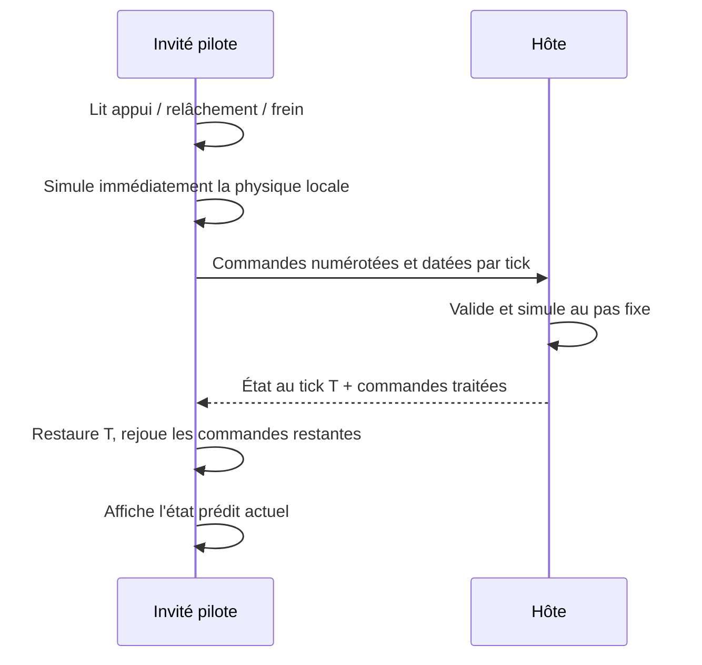

# Physique locale des invités : étude et architecture proposée

Étude du 18 octobre 2026 pour hybrid. **La prédiction physique décrite ici est une proposition ; elle n'est pas activée dans le jeu.** Les essais d'extrapolation compensant le délai n'ont pas été retenus pour publication. Les modifications d'arrivée et de vues spectateur sont indépendantes.

## Conclusion

Faire simuler immédiatement la voiture sur le navigateur de son pilote est la bonne direction pour rendre les pulsations d'accélérateur, le freinage et le dérapage réactifs. Je recommande **prédiction physique locale, hôte autoritaire et réconciliation par relecture des commandes**.

Ce choix conserve WebRTC et l'hôte actuel : il n'impose ni serveur dédié ni nouveau service. « Serveur » dans les références désigne ici le navigateur hôte. L'hôte conserve la décision officielle sur les collisions, tours, pénalités, coupures moteur et résultats. L'invité utilise réellement les mêmes forces et la même motricité que le solo pour sa réaction immédiate.

Le recalage reste nécessaire : on ne peut connaître instantanément les commandes d'un autre joueur à travers Internet. La différence fondamentale est que l'on calcule l'effet de **ses commandes actuelles**, plutôt que de prolonger seulement le dernier mouvement reçu.

## Ce que montrent les références

Sources consultées directement sur Internet, le 18 octobre 2026 :

1. [Gabriel Gambetta — Client-Side Prediction and Server Reconciliation](https://www.gabrielgambetta.com/client-side-prediction-server-reconciliation.html). Le modèle « envoi de commandes puis attente de l'état serveur » impose un aller-retour avant la réaction visible. Numéroter les commandes, simuler immédiatement puis rejouer celles que le serveur n'a pas encore acquittées évite cette attente locale.
2. [Gabriel Gambetta — Entity Interpolation](https://www.gabrielgambetta.com/entity-interpolation.html). L'auteur prend précisément l'exemple des courses automobiles pour expliquer l'extrapolation des adversaires, et sa faiblesse lors d'une collision. L'interpolation lisse des états connus, au prix d'un retard d'affichage : elle convient aux spectateurs et aux objets éloignés, mais ne remplace pas la réaction locale du pilote.
3. [Glenn Fiedler — Networked Physics, 2004](https://gafferongames.com/post/networked_physics_2004/). Même simulation, historique de commandes et d'états, retour à l'état corrigé puis relecture. Le texte précise que la solution simple convient surtout à des objets qui interagissent avec un monde statique : les contacts entre voitures demandent un traitement supplémentaire.
4. [Glenn Fiedler — State Synchronization](https://gafferongames.com/post/state_synchronization/). Envoyer commandes et états permet de simuler des deux côtés sans exiger un déterminisme parfait. Les commandes redondantes résistent aux pertes. L'état non visuel, la quantification et les erreurs de divergence doivent être traités explicitement.
5. [Unity Netcode for Entities 1.5 — Introduction to prediction](https://docs.unity.cn/Packages/com.unity.netcode@1.5/manual/intro-to-prediction.html) et [Physics](https://docs.unity.cn/Packages/com.unity.netcode@1.5/manual/physics.html). Documentation officielle : simulation locale avec les commandes du joueur, ticks communs, restauration du snapshot puis resimulation. Les objets physiques prédits peuvent nécessiter plusieurs pas par image ; les objets simplement interpolés suivent un autre traitement. La documentation détaille le coût CPU et les écarts introduits par la quantification.
6. [Glenn Fiedler — Choosing the right network model for your multiplayer game](https://mas-bandwidth.com/choosing-the-right-network-model-for-your-multiplayer-game/). Compare autorité distribuée, client/serveur, prédiction et lockstep/rollback. L'autorité distribuée donne une réaction immédiate mais nécessite d'arbitrer les interactions entre objets appartenant à des joueurs différents.
7. [SnapNet — Netcode Architectures Part 2: Rollback](https://www.snapnet.dev/blog/netcode-architectures-part-2-rollback/). Le rollback P2P complet exige sérialisation de l'état, pas fixes et déterminisme ; il oblige aussi à éviter les sons et effets répétés pendant les resimulations. Ce n'est pas la même exigence que le recalage d'un client depuis les snapshots d'un hôte autoritaire.

Ces références décrivent des principes et des implémentations ; elles ne garantissent pas le résultat dans notre moteur. Les réglages ci-dessous restent à mesurer sur le jeu.

## Comparaison pour Eyes On Line

| Architecture | Réponse à sa commande | Difficulté propre au jeu | Choix |
|---|---|---|---|
| Hôte seul, invité affiche les snapshots actuels | Attend l'aller-retour et les traitements | Dérapages et pulsations tardifs | Architecture actuelle, limite identifiée |
| Chaque client décide définitivement de sa voiture | Immédiate | Deux décisions concurrentes lors d'un choc, d'une poussée ou d'un passage de ligne | Possible en mode sans contact, peu adaptée à la course avec contacts |
| Client prédit, hôte valide, client rejoue ses commandes | Immédiate pour la simulation locale | État physique complet, relecture et contacts à traiter | Recommandé |
| P2P déterministe avec rollback de toute la course | Immédiate hors délai d'entrée éventuel | RNG, état complet, resimulation, différences de plateformes et coût mobile | Refactorisation plus lourde que nécessaire à ce stade |
| Lockstep sans prédiction | Attend les commandes manquantes | Le plus mauvais lien retarde le pilotage | Peu adapté aux pulsations rapides |

## Diagnostic du code actuel

- `js/main.js` : l'hôte appelle `Race.update`, l'invité appelle `Net.guestTick` puis `Race.extrapolate`. Le chemin invité ne fait pas tourner `Car.update` avec ses commandes locales.
- `js/net.js` : environ 30 snapshots/s. Les invités transmettent le dernier niveau de gaz, la ligne et les freins. Le numéro `n` ordonne les envois ; ce n'est pas un tick de simulation acquitté avec un état physique correspondant.
- `js/race.js` : pas fixe de 1/120 s déjà disponible, bon point de départ. L'extrapolation prolonge vitesse et rotation ; elle ne recalcule ni adhérence, ni saturation de l'essieu arrière, ni poussée depuis le nouvel appui du joueur.
- `js/util.js` : `ThrottlePulses` conserve les fronts d'appui pour la simulation locale. Le chemin réseau invité remet cet historique à zéro et publie surtout le niveau courant. Une pulsation entièrement comprise entre deux envois peut donc disparaître du flux reçu, ce qui compte particulièrement pour le pilotage slot.
- `Race.snapshot` / `js/paquet.js` : les 17 champs par voiture suffisent à l'affichage et à certains résultats, pas à redémarrer exactement la physique. Il manque notamment le braquage filtré, l'état d'aimantation, les mémoires de motricité et plusieurs temporisateurs.
- `Car.update`, `Car.steer`, `resolveCollisions` et les protections participent au résultat. Rejouer seulement `x/y/v` ne suffit pas.
- L'IA utilise `Math.random` (temporisation, bruit et dépassement). Elle reste aujourd'hui calculée par l'hôte. La rejouer dans un groupe de voitures prédites exigera de synchroniser sa décision ou un générateur pseudo-aléatoire reproductible.

Une reproduction locale de `Net.guestTick` a confirmé le cas limite : après un envoi à 1 000 ms, un appui à 1 005 ms puis un relâchement à 1 010 ms, le paquet suivant à 1 040 ms ne contient que zéro gaz. Le front pressé ne figure dans aucun paquet. Cet essai isole le protocole actuel ; il ne mesure pas la fréquence de ce cas sur un téléphone réel.

Ce sont des constats du code, distincts des recommandations des sources.

## Fonctionnement proposé

### Commandes

Utiliser un `raceId`, un tick physique entier et des commandes numérotées, avec gaz analogiques, frein, frein moteur, ligne et demande de stands. Enregistrer les transitions pressé/relâché au pas de simulation : un appui de 20 ms ne doit pas être remplacé par « relâché » parce que le paquet suivant part 33 ms plus tard.

Les paquets contiennent plusieurs commandes récentes non acquittées. L'hôte les déduplique et borne les durées/ticks acceptés. Une perte ne doit ni supprimer un coup de gaz, ni l'appliquer deux fois. Envoyer à 20–30 Hz n'oblige pas à échantillonner le pilotage à cette fréquence.

Conserver d'abord le pas physique 120 Hz existant, avec un tick réseau 30 Hz comme point de départ. Le navigateur invité doit disposer d'une estimation du tick hôte et d'une courte avance de commandes ajustée au délai et à sa variation. Le nombre de ticks d'avance devra être mesuré, pas choisi depuis un RTT supposé constant.

### État physique et réconciliation

Créer des fonctions explicites `capturePhysicsState` / `restorePhysicsState`. Elles incluent les variables qui influencent le pas suivant : position, vitesse, vitesse latérale, lacet, braquage, ligne filtrée, état et mémoire d'aimantation, glisse/motricité, freinage, temporisateurs moteur et sortie, usure/dégâts/stands lorsqu'activés. Séparer les références de modèle/circuit des valeurs sauvegardées, et les références à d'autres voitures des identifiants stables.

L'état officiel transporte le tick exact auquel il correspond et l'acquittement des commandes de chaque pilote. Au retour d'un snapshot, restaurer cet état puis rejouer uniquement les commandes postérieures. Le rendu peut lisser la correction visuelle ; la physique ne doit pas être progressivement tirée vers une position ancienne.

Les paramètres utilisés par les deux simulations doivent être identiques : version de physique, modèle, réglage de freinage, aides, usure et géométrie/collisions du circuit. L'état physique de reprise mérite un format distinct du paquet visuel quantifié actuel, ou une quantification appliquée de manière cohérente des deux côtés.

### Collisions : partie essentielle

La validation initiale peut se faire en mode `ghost`, avec la voiture du joueur et les barrières statiques. Ce sera un jalon de test, pas une livraison annoncée comme résolvant la course avec contacts.

Pour la course normale, les voitures susceptibles de se toucher doivent être prédites sur le **même tick**. Deux stratégies à comparer :

- prédire/rejouer toute la petite grille (jusqu'à 12 voitures), plus simple pour garder l'ordre des interactions ;
- prédire un groupe de voitures voisines et conserver les autres dans un état d'affichage interpolé, plus économique mais avec des transitions et des dépendances à traiter.

Je recommande de mesurer d'abord la petite grille complète pour la simulation prédite, en laissant à l'hôte les décisions officielles et en resynchronisant régulièrement les états profonds. L'IA et les autres pilotes utilisent des commandes connues ou provisoires pendant la courte fenêtre prédite. Ce n'est pas un passage automatique au rollback P2P déterministe : on dispose toujours de snapshots hôte pour corriger les divergences. Le choix final de l'étendue prédite dépendra du coût sur téléphone.

Un objet seulement interpolé ne doit pas devenir, par défaut, un obstacle dynamique « immuable » dans le présent du pilote. L'hôte tranche le contact ; le client peut en prévoir la réaction puis la corriger. Des corrections resteront possibles quand un adversaire change brutalement de commande ou heurte une barrière.

### Chronos, sons et spectateurs

- Les tours, fautes, résultats et records officiels sont produits une seule fois par l'hôte.
- Le client peut jouer immédiatement les effets de sa motricité prédite ; les événements ponctuels doivent avoir des identifiants pour ne pas doubler un choc ou un tour à chaque relecture.
- Les spectateurs n'ont pas de commande locale à rendre immédiate. Un petit tampon d'interpolation de toute la course donnera une image cohérente ; le réalisateur et les chronos suivent ce temps de présentation commun.
- L'arrivée en cours de partie restaure un état complet et un `raceId`/tick courant. Un spectateur ne simule pas une seconde course officielle.

## Plan de réalisation et critères de validation

1. Versionner le protocole, fixer les ticks et sérialiser l'état de reprise. Démontrer que restauration + relecture d'une même séquence donne le même résultat à la tolérance physique définie.
2. Ajouter le journal des commandes et leur acquittement. Vérifier les pulsations de 10, 20, 40 et 80 ms, y compris plusieurs transitions dans un même paquet, les freins analogiques et les pertes/doublons/désordres.
3. Brancher la prédiction locale en mode sans contact, avec le même moteur et les protections. Vérifier que le premier effet local arrive au prochain pas physique/à la prochaine image, indépendamment de l'aller-retour.
4. Ajouter la grille prédite et les collisions, avec reprise depuis un état commun. Ne généraliser à la course normale qu'après validation des chocs latéraux, freinages brusques, bacs à gravier, barrières et passages de ligne en paquet.
5. Raccorder sons/effets, résultats, arrivée tardive et vues spectateur. Garder le chemin existant disponible pendant la comparaison.

Matrice de test prévue : 2/4/8 pilotes, plateaux avec IA, RTT 0/60/120/200 ms, variation de délai et pertes 0/1/5 %, mobile/tablette/PC. Spa, Monaco, Monza et Zandvoort couvrent virages rapides, murs rapprochés et contacts. Mesurer séparément délai commande→effet local, erreur de position/angle, fréquence et amplitude des corrections, coût CPU des relectures, trafic et exactitude du classement. Ces tests d'architecture ne sont **pas encore exécutés** : ce document définit les vérifications nécessaires, pas une amélioration déjà prouvée en production.

Le prototype de compensation visuelle testé précédemment n'utilisait pas les nouvelles commandes pour simuler les pneus. Même s'il réduit une erreur d'affichage sur un signal synthétique, il ne répond pas à lui seul au besoin de contrôle par pulsations ; ses chiffres ne valident pas cette architecture.
