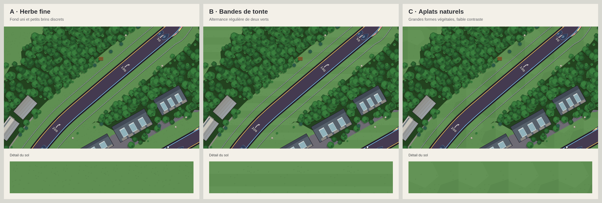
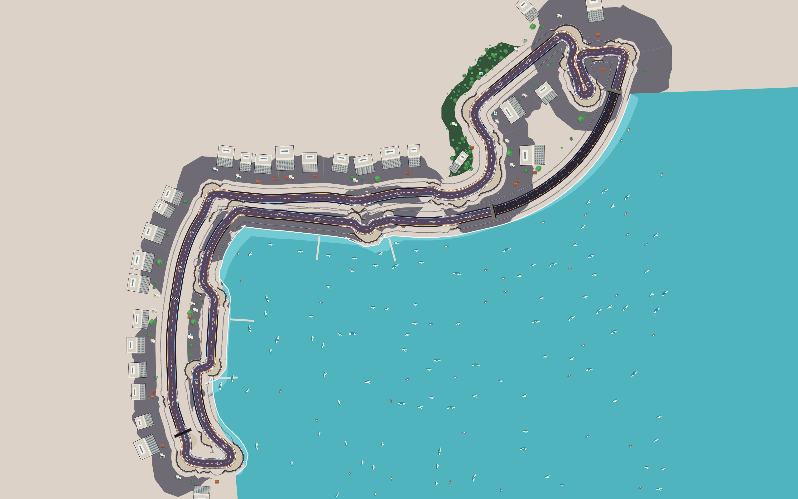
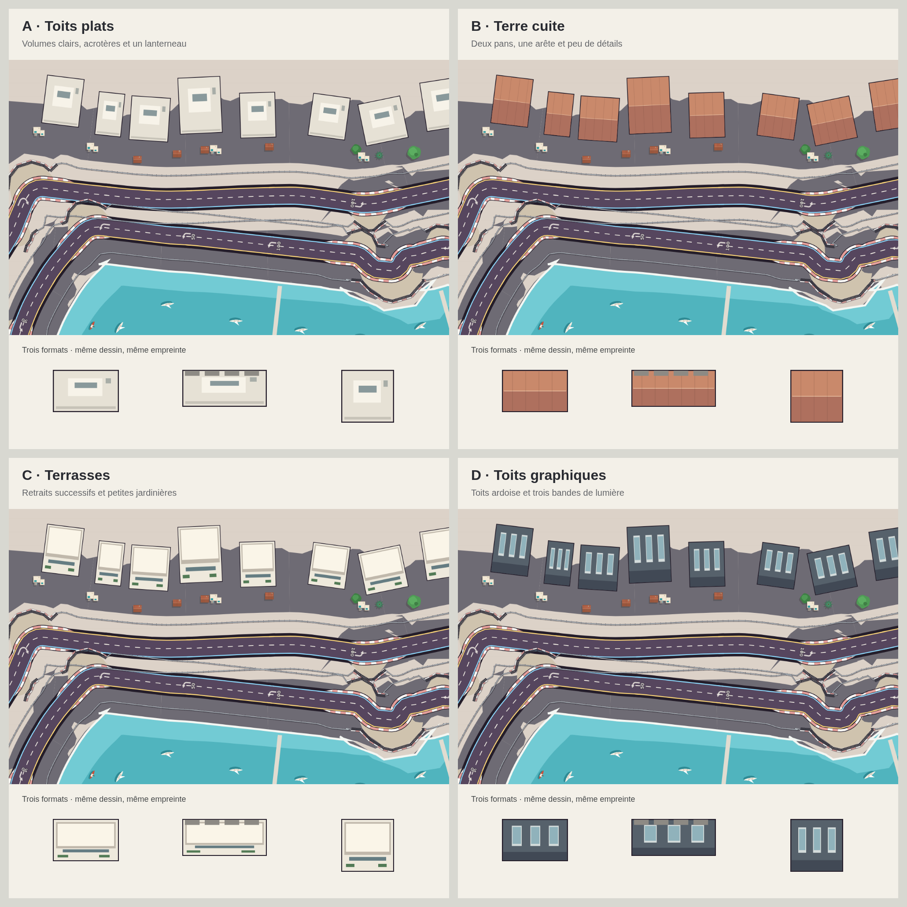
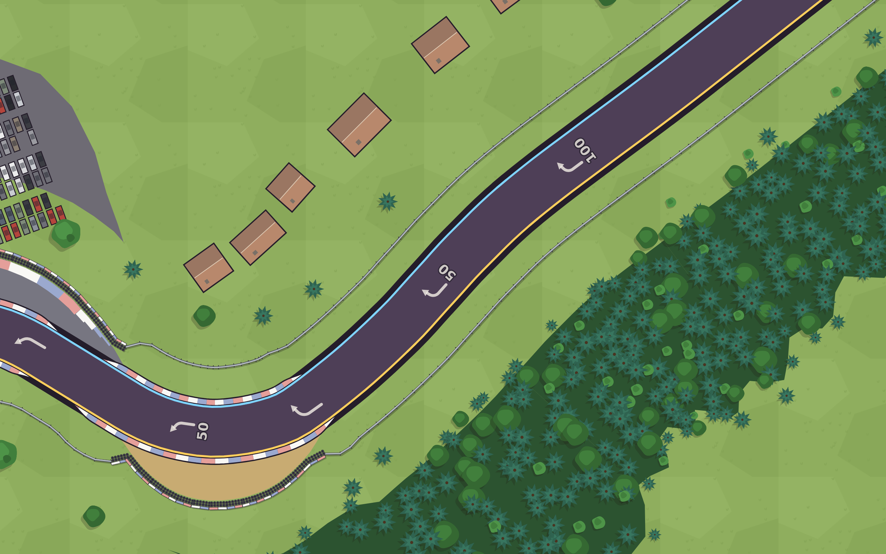
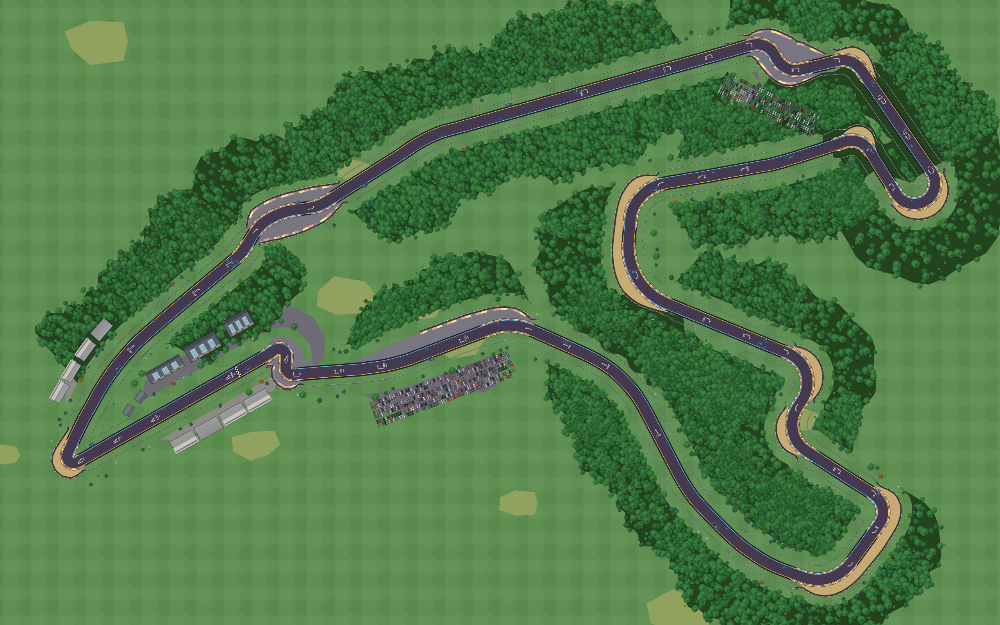

# Décor hybrid — corrections et propositions

Version 0.26.0, 16 octobre 2026. Tous les dessins sont des formes Canvas : les PNG de ce dossier servent à comparer les propositions et ne sont pas chargés par le jeu.

## Barrières

Sur les portions en herbe, la limite de pose passe de 2,2 à 9 m au-delà du vibreur : **6,8 m de recul supplémentaire** dans les mètres du jeu. Un raccord progressif accompagne les entrées et sorties de dégagement. À partir de 6 m de largeur de gravier ou de bitume, la règle précédente est conservée. Le dessin, les collisions et le recul du décor utilisent toujours `Track.limiteProtection`.

Les protections peuvent être plus proches localement dans les épingles, où leur contour est corrigé pour éviter un repli. La largeur annoncée décrit la règle de décalage du tracé, pas une mesure cadastrale de chaque segment après ces corrections.

## Herbe : trois propositions

Les ovales bruns ont été retirés. Le choix retenu est **C — Aplats naturels**. De rares zones d’herbe séchée, plus jaunes, sont réparties à des positions stables dans le paysage. Elles ne remplacent ni les graviers ni les sols boisés. Les couleurs restent propres à chaque circuit. Monaco garde un sol minéral avec quelques joints discrets.



| Variante | Aspect | Vue individuelle |
| --- | --- | --- |
| A — Herbe fine | Fond presque uni, petits brins espacés | [PNG](grass-prairie.png) |
| B — Bandes de tonte | Deux verts alternés, entretien régulier | [PNG](grass-tonte.png) |
| C — Aplats naturels | Grandes formes végétales à faible contraste | [PNG](grass-aplats.png) |

Le même cadrage de Spa et le même décor sont utilisés ; un échantillon plus grand du sol figure sous chaque vue. La trame est déterministe et précalculée au chargement du circuit.

## Monaco : port Hercule

La baie n'est plus un paramètre du thème Riviera attaché au premier tiers du tour. Elle est définie pour Monaco, côté intérieur depuis le Portier, le long du tunnel, puis Tabac et la Piscine, d'après `art/reprise circuit/monaco.jpg` et `monaco_2.jpg`.

Le littoral suit aussi le contour rouge fourni par Bruno devant le tunnel. La rive suit l'enveloppe des protections et le quai ; le bord au large est défini indépendamment des normales de chaque virage, qui repliaient la baie dans les changements de direction. La mer se prolonge hors du cadre, avec quelques pontons. Les bateaux sont concentrés dans le bassin visible.

L'implantation écarte une empreinte de bâtiment ou de voiture de parking dès qu'elle recouvre l'eau : coins contenus, eau contenue ou croisement d'arêtes. Les arbres et les petits objets sont également exclus de l'eau. Ces tests utilisent le même polygone que le dessin de la mer.



[Voir les immeubles en détail](monaco-immeubles-detail.png)

## Bâtiments : quatre propositions

Les quatre dessins ci-dessous restent disponibles pour comparaison. Le décor final varie désormais par circuit, selon le choix précisé ensuite par Bruno. Les stands gardent leur fonction de garages et les tribunes leurs gradins. Les propositions utilisent exactement la même implantation et les mêmes empreintes au sol. Les tribunes gardent leurs gradins.



| Variante | Aspect | Vue individuelle |
| --- | --- | --- |
| A — Toits plats | Tons clairs, acrotères, petit lanterneau | [PNG](buildings-plats.png) |
| B — Terre cuite | Deux pans, arête centrale, quelques lignes | [PNG](buildings-terrecuite.png) |
| C — Terrasses | Retraits clairs, vitrage, petites jardinières | [PNG](buildings-terrasses.png) |
| D — Toits graphiques | Ardoise sombre, trois bandes de lumière | [PNG](buildings-graphique.png) |

## Architecture retenue par circuit

| Circuit | Bâtiments du paysage |
| --- | --- |
| Monaco | Immeubles hauts, hauteurs visuelles variées de 22 à 48 m, toits en retrait et façades avec étages |
| Le Mans | Petits pavillons de 8 à 11 m de profondeur, 4 à 6 m de haut ; suppression de leurs anciennes dalles de hangars |
| Monza, Spa, Nürburgring, Laguna Seca, Bathurst | Pavillons, avec des teintes de toiture adaptées au thème |
| Silverstone, Suzuka | Ateliers et hangars aux toits graphiques |
| Interlagos, Paul Ricard, Zandvoort | Volumes bas à toits plats |
| Red Bull Ring | Volumes en terrasses |

Les stands conservent des modules de garage et les tribunes leurs gradins. Les immeubles sont dessinés dans leur emprise au sol : la lecture de la hauteur vient des étages et des retraits, sans ajouter une caméra en perspective. Les dimensions sont celles du modèle stylisé, pas des relevés bâtiment par bâtiment.

[Vue complète du Mans](lemans-pavillons.png)





## Vérifications

- `node tools/marina-banc.js` : bon côté du port, mer devant le tunnel, pas de mer sur l'axe de la piste, pas de bâtiment/voiture/arbre dans le bassin, bateaux dans l'eau, empreintes traversant une arête, recul accru sur l'herbe et placement conservé dans les grands dégagements des 13 circuits ; différences de hauteur et de taille entre les immeubles de Monaco et les pavillons du Mans.
- `node tools/decor-banc.js` : aucun arbre sur la piste, dans un dégagement ni sur un bâtiment sur les 13 circuits.
- `node tools/degagements-banc.js` et `node tools/barrieres-banc.js` : surfaces, limites, collisions et reprise après choc.
- `tools/e2e-barrieres.js` : rendu, son, collision et marina sur Chromium mobile 390 × 844, DPR 3 et bureau 1280 × 800. Le banc navigateur suit désormais le rebond existant et les protections existantes de Monza, plutôt que les anciennes attentes « vitesse nulle au choc » et « aucun rail à Monza ».

Ces essais Chromium ne sont pas un test sur iPhone physique.

## Régénérer les comparatifs

```sh
node tools/propositions-decor.js /tmp/propositions-decor
node tools/export-decor.js /tmp/monaco monaco
```

Playwright et Chromium doivent être disponibles. Les variantes sont rendues par les fonctions du jeu, puis assemblées par Canvas pour la comparaison.
