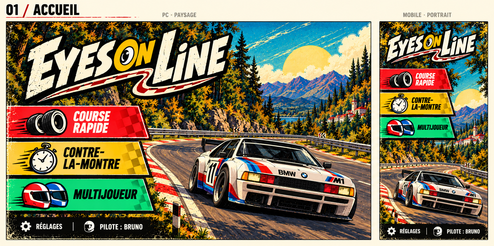
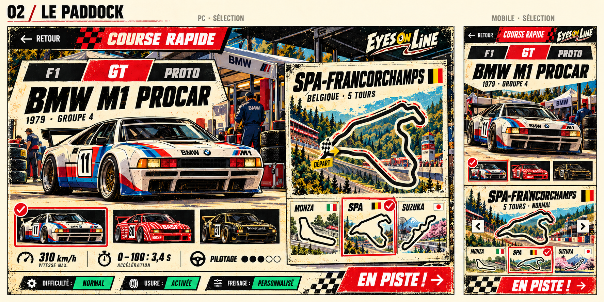
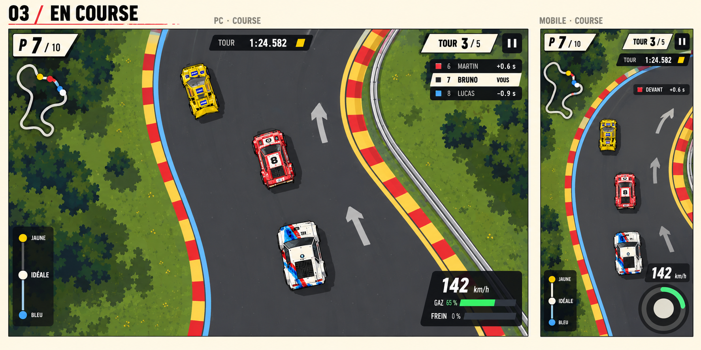

# Propositions visuelles — Eyes On Line

**Intégrées et affinées en version 0.38.1 : [captures réelles et vérifications](../interface-paddock/README.md).** Les images ci-dessous restent les maquettes de conception.

Trois maquettes de direction artistique, chacune en paysage PC et portrait mobile, proposées avant de coder les interfaces. Elles prolongent [l’audit consacré à la conception de jeu vidéo](../audit-interface-jeu/README.md).

## 1. Accueil : affiche de course vivante

L’illustration, le logo expressif et les bandeaux de modes donnent une identité de jeu de course rétro. La composition paysage est dédiée au PC.

## 2. Sélection : le paddock

La voiture et le circuit occupent le premier plan, avec des fiches techniques et un bouton de départ clair. Sur mobile, les choix s’empilent.

## 3. En course : une interface plus discrète

Le vocabulaire graphique reste cohérent avec les menus, mais les textures et ornements diminuent pour laisser lire la piste. Le classement relatif rend les concurrents proches visibles.

## Portée des images

Ces images générées sont des propositions, pas des captures d’une interface implémentée. Les chiffres, performances, tracés et livrées sont illustratifs. Elles ne modifient ni les paramètres physiques ni les assets du jeu.

Les gros chiffres et les flèches au sol, les bordures jaunes et bleues ainsi que les informations indispensables au gameplay doivent être conservés lors d’une éventuelle réalisation, même lorsque la génération ne les représente pas tous. Les dimensions et contrastes devront être vérifiés dans le jeu réel, au clavier, au tactile et à la manette.

Les propositions ont ensuite servi à la refonte 0.38.0 ; les captures du résultat sont dans le lien en tête de page.

## Clarifications retenues

- Accueil PC : une seule scène cohérente, voiture sur la piste et perspective commune aux barrières et au décor. La maquette d’accueil ci-dessus a été corrigée.
- Accueil mobile : réglages et nom du pilote toujours présents ; prévoir la zone de sécurité du téléphone à l’intégration.
- Menus : conserver la direction paddock et séparer le fond, les voitures, les textes et les commandes.
- Course : commandes noires et panneaux beiges ; conserver les marquages de gameplay existants.
- Rédaction : pas de slogans ni de petites phrases descriptives. Conserver les libellés d’action, les noms, les valeurs et les aides réellement utiles aux commandes.

## Fonds préparés

[Galerie du paddock et des 13 circuits](fonds/README.md). Ces assets sont intégrés aux sélections en WebP ; ils ne remplacent pas les décors de course.

Validation de la suppression des accroches : scénario existant `tools/e2e-menu.js` réussi sur PC, PC compact, mobile, petit mobile et tablette ; navigation FR/EN et salon multijoueur connecté, sans erreur navigateur. Version 0.37.1.
