# Fonds de sélection

Fonds illustrés sans interface ni voiture, destinés aux futurs menus. Les scènes évoquent les lieux ; ce ne sont pas des relevés géographiques. Les tracés exacts devront être dessinés séparément à partir des données du jeu, avec un support contrasté pour rester lisibles.

Le paddock réserve le premier plan à une voiture. Les sprites actuels vus du dessus ne sont pas des illustrations de trois-quarts : prévoir une présentation dédiée ou une illustration de sélection séparée, sans déformer les sprites de course.

Le jeu utilise les versions WebP optimisées dans `art/interface/` : fond sélectionné dans l’aperçu et miniatures dans le rail. Ces PNG restent les sources de conception.

## Paddock

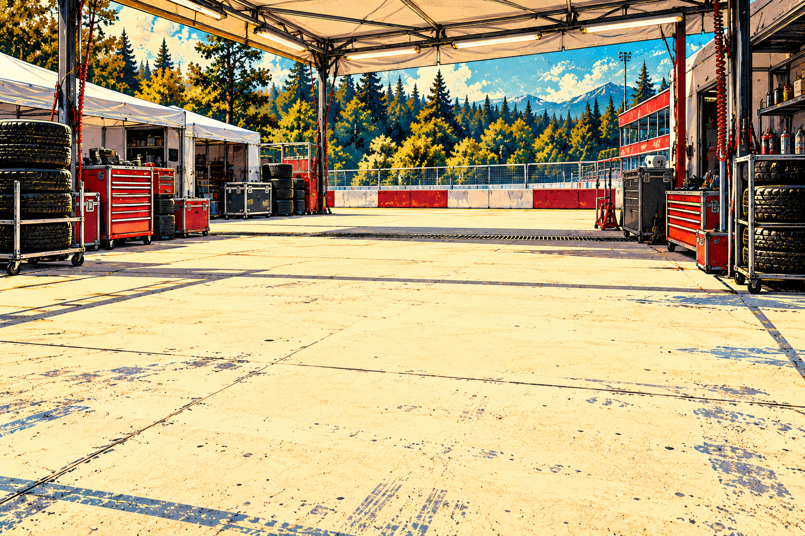

## Monza

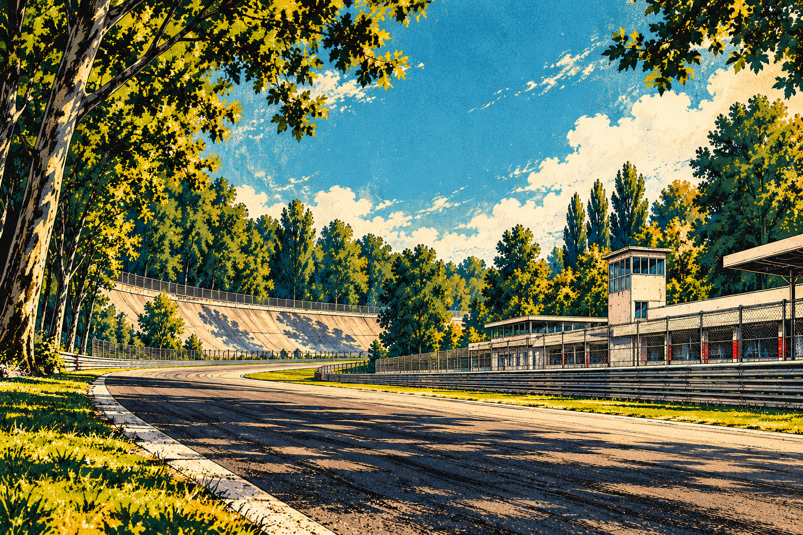

## Spa-Francorchamps

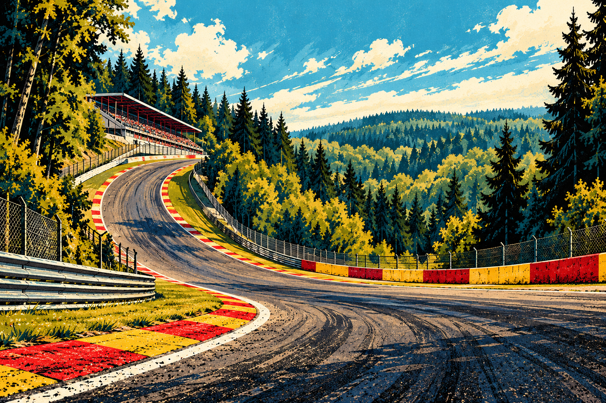

## Monaco

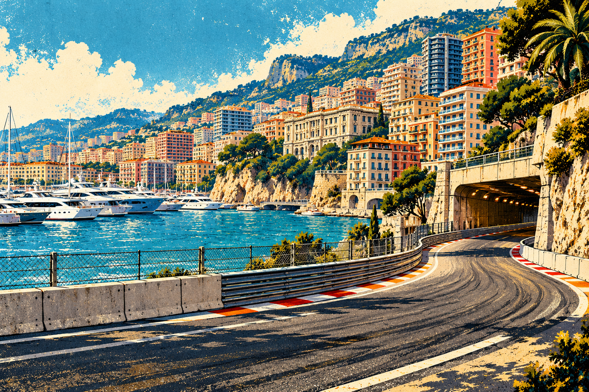

## Silverstone

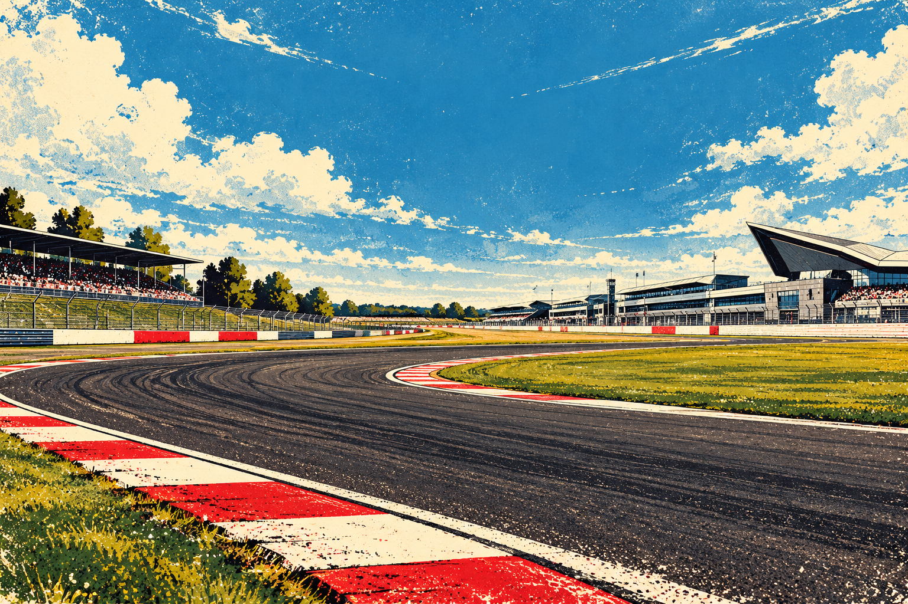

## Suzuka

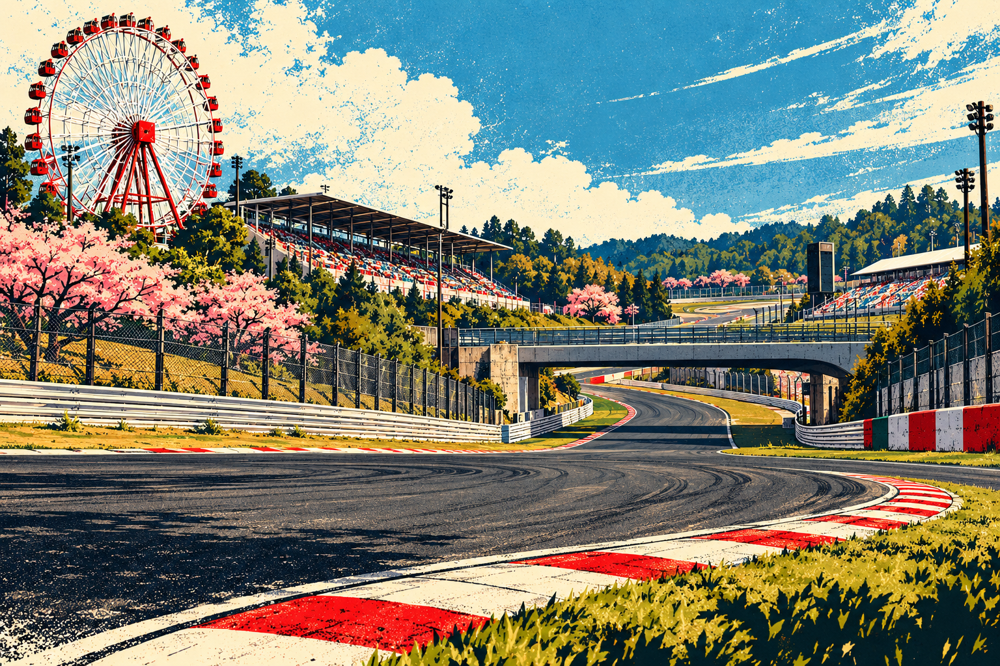

## Interlagos

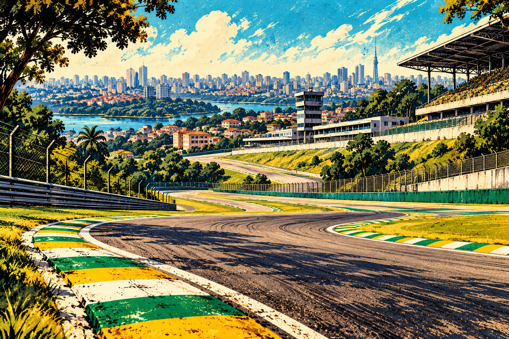

## Laguna Seca

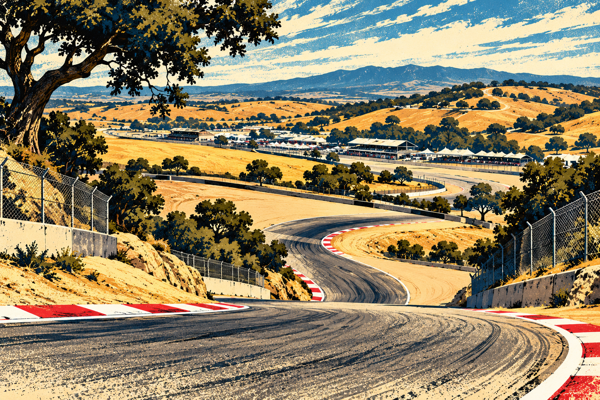

## Nürburgring GP

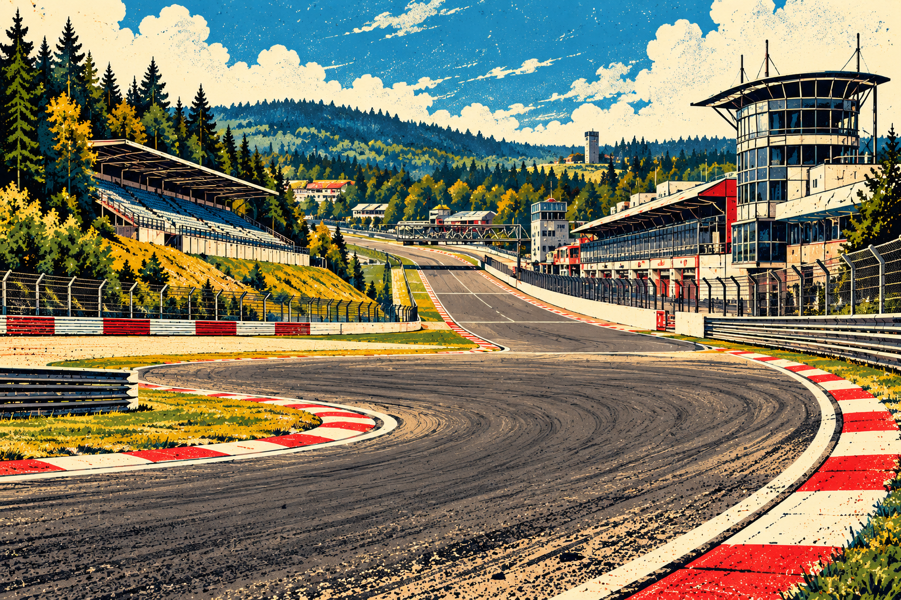

## Le Mans

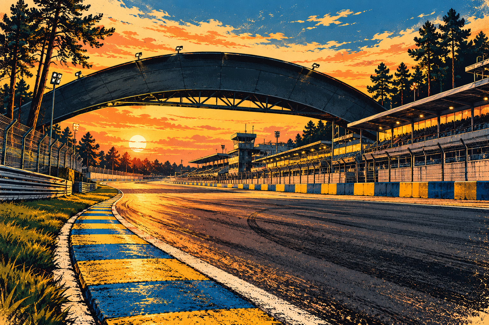

## Mount Panorama

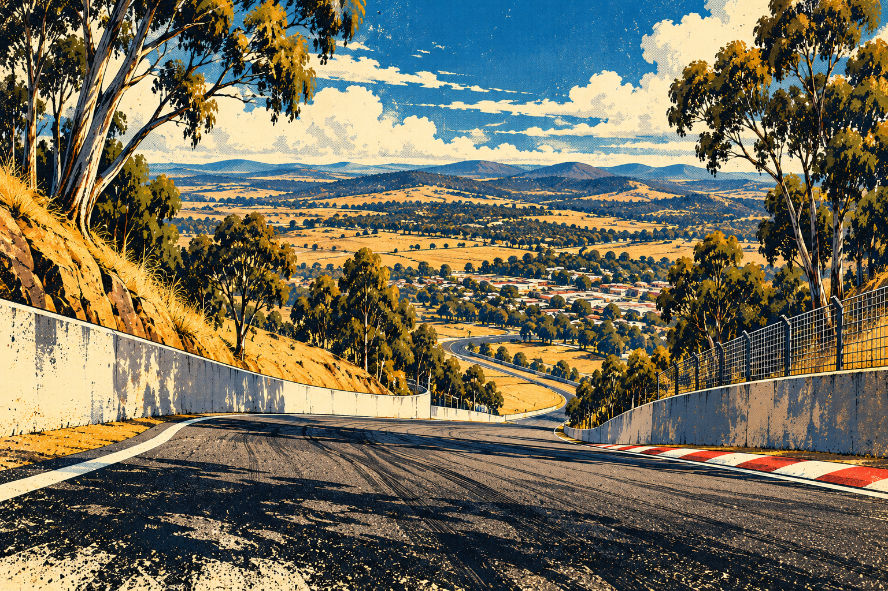

## Red Bull Ring

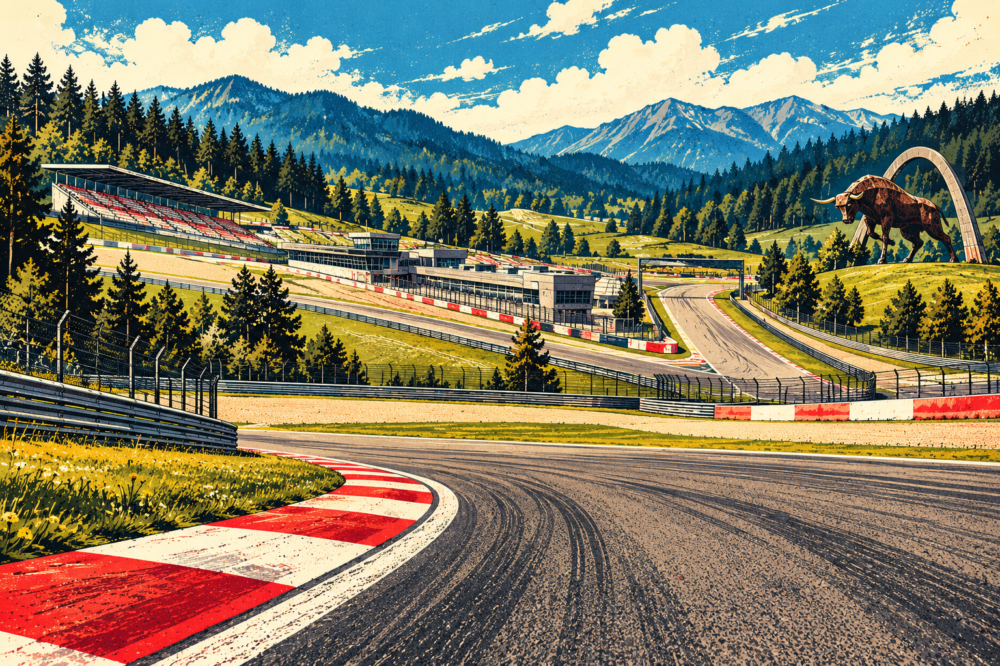

## Paul Ricard

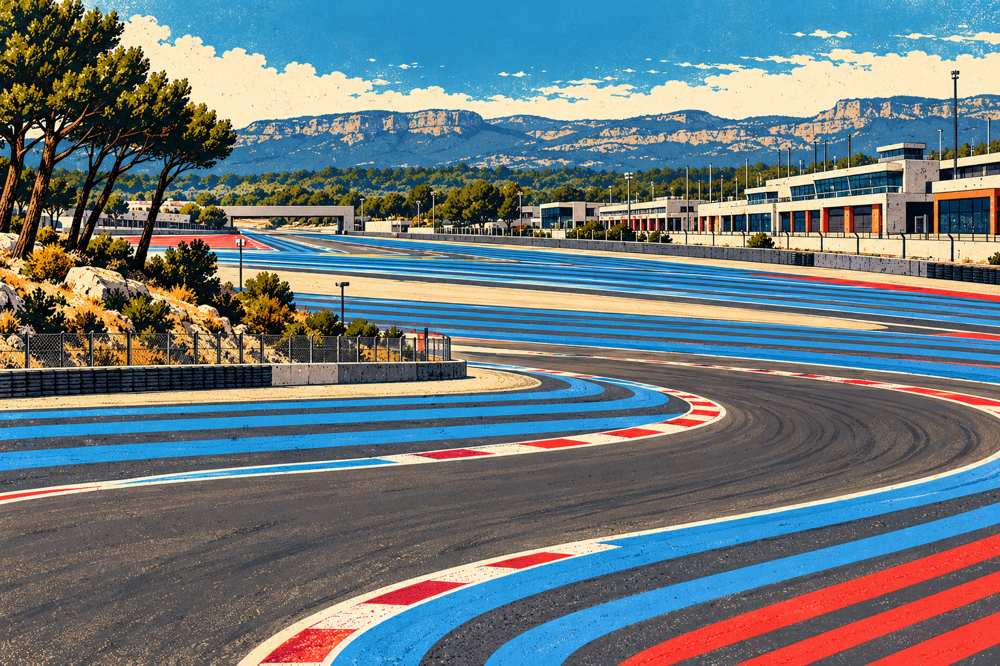

## Zandvoort

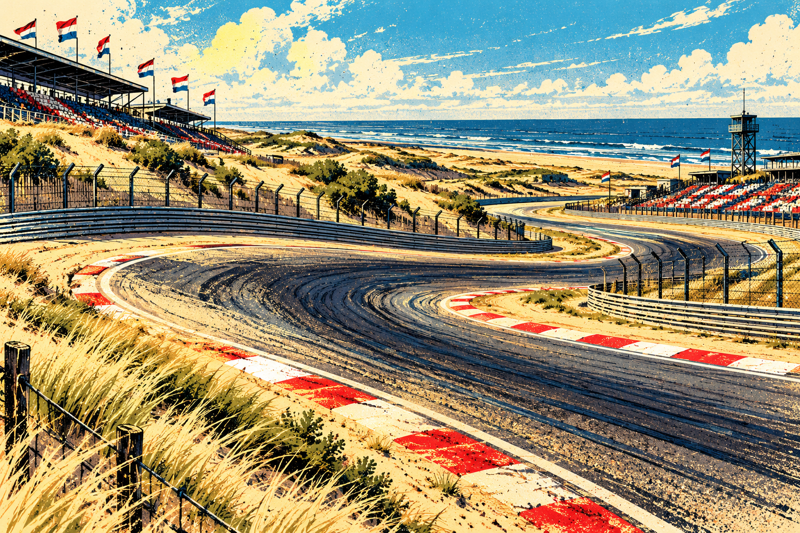
