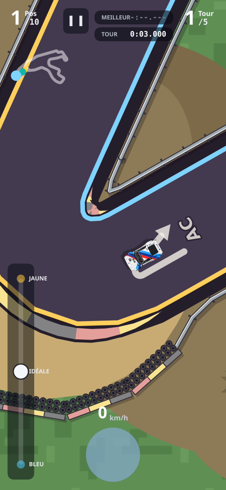
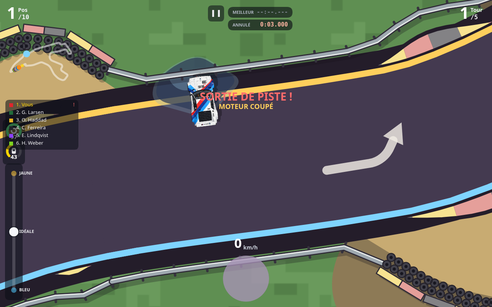

# Essai de barrières — Spa hybride

**Mise à jour 0.25.0 :** les annotations de Spa définissent maintenant les dégagements en bitume et les bacs corrigés. Voir [l’analyse, les règles et la capture complète](zones.md).

Activé uniquement sur Spa, dans `claude/hybrid-racing-game-2d-jkk7q0`. Les protections sont dessinées par Canvas (`Path2D`, traits, polygones et cercles), sans charger d'image. Les chemins sont préparés au chargement du circuit et regroupés pour ne dessiner que les portions visibles.

## Décor et tracé

- Glissières métalliques des deux côtés, en retrait du bord et des vibreurs.
- À l'extérieur des bacs : blocs reprenant exactement les couleurs des vibreurs du circuit et deux rangées de pneus côté piste.
- Ouverture conservée du côté des stands, de l'entrée à la sortie.
- Retrait des objets de décor qui recouvriraient les protections.
- Suppression des boucles que le décalage du bord produit à l'intérieur des épingles.

Le profil initial des bacs (version 0.24.0) reprend le travail de Claude présent dans `28a9082` et `4cf3098` : courbure lissée, largeur normalisée à 12 m avant lissage du raccord, ouverture progressive et dégagement uniquement à l'extérieur du virage. Dans cette version initiale, les 3 400 valeurs de chaque côté de Spa ont été comparées à la branche Game Boy : elles sont identiques. Un contour continu évite les facettes entre les anciens polygones de virage.

Le même ensemble de segments sert au dessin et aux collisions. La carrosserie est approchée par trois disques et balayée entre deux pas physiques, ce qui détecte aussi un mur traversé entièrement entre deux positions. Les pneus forment une protection continue : leurs petits interstices ne permettent pas de passer au travers.

## Conséquences d'un choc

1. Arrêt immédiat des vitesses longitudinale, latérale et de rotation.
2. Coupure moteur, y compris son, de 0,25 à 5 secondes. Sa durée dépend du carré de la composante de vitesse perpendiculaire à la protection : un frottement est moins sévère qu'un impact frontal.
3. Les deux rangées de pneus ramènent cette vitesse effective à 55 % pour calculer la coupure et les dégâts. Elles amortissent donc le choc sans laisser traverser la protection.
4. Dégâts ajoutés seulement avec l'option d'usure/dégâts active, en utilisant le seuil et le coefficient de choc existants.
5. Sortie de piste comptée et tour invalidé. Une excursion dans le gravier suivie d'un impact reste une seule sortie ; rester au contact ne cumule pas les fautes ni les dégâts.

À la fin de la coupure, la voiture se réaligne sur place dans le sens de la piste. Cela permet de repartir avec la commande unique, sans marche arrière. Le secours existant après huit secondes hors piste reste disponible, mais attend la fin d'une éventuelle coupure moteur.

L'hôte simule le choc en multijoueur. La combinaison jusque-là impossible « gaz + frein » des drapeaux réseau transmet l'état moteur coupé, sans agrandir le paquet. Le client affiche cet état et coupe le son ; la durée précise reste gérée par l'hôte. Les joueurs doivent utiliser cette même version pour interpréter ce nouveau drapeau.

## Validation

- 243 impacts contrôlés : neuf voitures, vitesses 10 / 30 / 60 m/s, trois angles, glissière ou pneus, dégâts actifs ou désactivés.
- Balayage rapide du corps et des extrémités, absence de collision en s'éloignant, absence de protections sur l'asphalte, accès aux stands.
- Arrêt, fin de coupure, reprise, absence de faute répétée, secours différé et remise à zéro.
- Transmission de la coupure et du redémarrage par le codec réseau.
- Chromium en 390 × 844 (DPR 3) et 1280 × 800 : dessin, impact obtenu par la physique, affichage, extinction et reprise du son moteur, changement vers un circuit sans barrières.
- 18 essais de deux tours, neuf voitures et deux graines, sur Spa avec huit concurrents : tous terminés avec un tour propre disponible. Huit sorties du joueur et 24 sorties d'adversaires sur l'ensemble, conservées dans [les résultats](peloton.json). Ces compteurs incluent toutes les sorties, pas seulement les impacts de barrière.
- Banc des stands sur Spa : arrêt et sortie de la voie réussis.
- Banc des sorties, codec (11 784 instantanés), effets de patinage et pulsations : réussis.

Ces tests sont simulés ou exécutés dans Chromium ; ils ne constituent pas une validation sur un iPhone physique. Le fichier peloton a été enregistré avant les derniers garde-fous empêchant le secours d'interrompre la coupure et neutralisant la poussée d'une autre voiture pendant celle-ci. Ces garde-fous sont couverts par les tests ciblés.

## Reproduire

```sh
node tools/barrieres-banc.js
node tools/e2e-barrieres.js /tmp/spa-barrieres
node tools/stands.js spa
node tools/sortie.js
node tools/paquet-banc.js
node tools/patinage-banc.js
node tools/pulsations-entree.js
node tools/motricite-banc.js --factors=live --tracks=spa --traffic=8 --seeds=42761,20261014 --out=/tmp/spa-barrieres-peloton.json
```

Les tests navigateur nécessitent Playwright et Chromium. Les captures ci-dessous documentent le rendu ; le jeu ne les charge pas.




