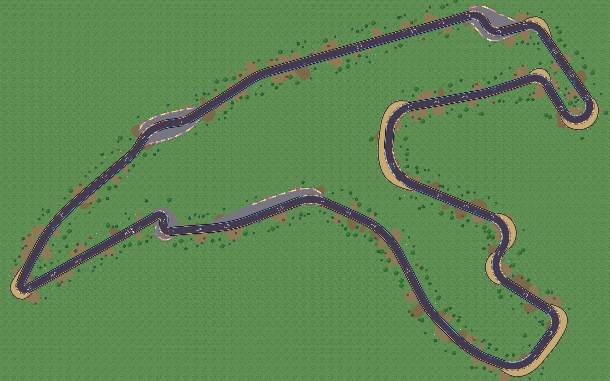
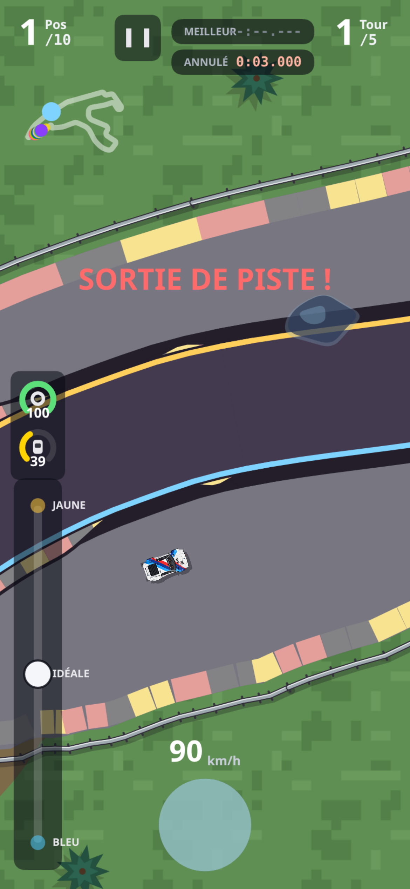

# Spa — dégagements d'après les annotations

Version 0.25.0, branche hybrid, 16 octobre 2026.



## Lecture des références

Les contours de [spa-tour_reprise.png](../../art/reprise%20circuit/spa-tour_reprise.png) donnent les modifications prioritaires. Le [plan des zones de Spa](../../art/reprise%20circuit/circuit_spa_zones.png) permet de reconnaître les complexes et les matériaux ; la [photo de Raidillon](../../art/reprise%20circuit/bord_piste_bitume.png) inspire le bitume gris et sa bordure peinte aux couleurs des vibreurs. Les images servent de références : les surfaces et les protections restent dessinées par Canvas.

| Annotation | Secteur | Modification |
| --- | --- | --- |
| Vert | Eau Rouge / Raidillon | Bitume continu des deux côtés, avec des largeurs différentes |
| Vert | Les Combes | Deux dégagements bitumés couvrant l'enchaînement |
| Vert | Blanchimont | Long dégagement bitumé extérieur, prolongé dans la sortie |
| Vert | Bus Stop | Bitume des deux côtés de la chicane ; accès aux stands conservé |
| Rouge | La Source | Contour du gravier repris autour de l'épingle |
| Rouge | Malmedy, après Les Combes | Gravier redessiné à l'extérieur |
| Rouge | Pouhon / Double Gauche | Un seul bac continu entre les deux courbes |
| Rouge | Campus / Paul Frère | Un seul bac enveloppant le complexe |
| Bleu | Avant Eau Rouge | Suppression du petit bac côté droit |

Les annotations priment lorsque le plan fourni suggère un autre matériau, notamment à La Source et Pouhon. Il s'agit d'une adaptation au tracé et aux proportions du jeu, pas d'un relevé d'homologation du circuit actuel. Les secteurs non annotés de Spa conservent leur profil précédent.

## Règles de placement

Le profil automatique fondé sur la courbure détectait séparément chaque virage : il produisait des bacs courts, parfois séparés par de l'herbe au milieu d'un même complexe. Les secteurs annotés ont désormais des définitions explicites dans `TRACKS.spa.runoffs` : nom, côté, matière et couples `[fraction du tour, largeur hors route en mètres du jeu]`.

Les points ont été relevés sur les traits colorés de l'export 2560 × 1600, projetés sur le tracé, puis simplifiés. Des raccords réduisent la largeur à zéro aux extrémités. Une interpolation continue permet de prolonger le dégagement au-delà d'un apex et de relier deux courbes. La matière `grass` supprime un bac au lieu de laisser la détection automatique le recréer. En cas de chevauchement de définitions, la dernière est prioritaire ; les secteurs voisins de Spa ont des extrémités communes.

Le même profil dimensionne les surfaces, éloigne les arbres et accessoires, et place les protections à l'extérieur du dégagement. Les deux rangées de pneus et leurs blocs restent associées au gravier ; les zones bitumées sont bordées de glissières. La bande peinte suit les segments de protection après suppression des boucles dans les chicanes. Elle s'interrompt aux ouvertures des stands.

Ces règles sont disponibles pour les autres circuits. Leurs zones seront définies à partir des prochaines images fournies, circuit par circuit : aucun matériau ou secteur de Spa ne leur a été recopié automatiquement.

## Conduite et limites de piste

La matière du sol est séparée de la limite sportive :

- Route et vibreurs : mêmes règles qu'avant.
- Bitume de dégagement : adhérence et partage de motricité de l'asphalte, sans traînée de gravier. Les traces, la fumée de pneus et le son de patinage restent possibles.
- Herbe et gravier : comportement de ralentissement et effets précédents.
- Au-delà du vibreur et de la tolérance habituelle, **le bitume compte toujours comme une sortie** : faute, tour invalidé et reprise du temps gagné en coupant. Les aides de maintien sur la ligne ne sont pas réactivées hors piste.
- Les collisions gardent l'arrêt, la coupure moteur proportionnelle au choc et les dégâts optionnels.

La matière est recalculée depuis la position ; aucun champ réseau supplémentaire n'est nécessaire.



## Validation

- `node tools/degagements-banc.js` : contours et raccords des zones, suppression bleue, fin du bitume, barrières extérieures, neuf voitures comparées à état identique sur route/bitume/gravier, sortie toujours sanctionnée, zones traversant le départ et absence de modification des autres circuits.
- `node tools/barrieres-banc.js` : 243 impacts, coupure et redémarrage, amortissement, dégâts, stands ouverts et état réseau.
- `node tools/e2e-barrieres.js /tmp/spa-zones` : Chromium en 390 × 844, DPR 3 et 1280 × 800 ; rendu, collision réelle, son moteur, absence de poussière/bruit de gravier sur le bitume, traces/son de pneus, retour des effets de sol meuble et changement de circuit.
- Bancs `sortie.js`, `stands.js spa` et `patinage-banc.js` : réussis.

Les essais mobiles sont des simulations Chromium, pas un test sur iPhone physique.

## Exporter

L'outil existant accepte maintenant un circuit facultatif et un dossier extérieur au dépôt, y compris pour sa planche récapitulative :

```sh
node tools/export-decor.js /tmp/spa-zones spa
```

Il produit une vue complète, quatre détails et une planche. Sans le dernier argument, il exporte tous les circuits. Playwright et Chromium doivent être disponibles.
