# Voitures cartoon — 0.41.0

25 modèles, 57 livrées, 114 images remplacées : vue de course et vue de sélection.
Les illustrations sont générées à partir des voitures existantes, puis détourées et
dimensionnées pour le jeu. Les grandes couleurs et les numéros identifient les
livrées ; les petits sponsors, les intérieurs et les détails mécaniques sont simplifiés.
Les vues de sélection utilisent une caméra trois-quarts plus basse, notamment la GT40.

## M1 Procar : garde-boue conservés

Les ailes avant font partie de la carrosserie, **pas des roues à supprimer**.
Les trois livrées ont leurs ailes élargies et anguleuses restaurées à partir de
la silhouette d'origine. Les pneus mobiles sont placés dessous : droits, ils sont
masqués par les ailes ; braqués, leurs extrémités apparaissent.

Le comparatif ci-dessous montre les fichiers de carrosserie : les roues avant
séparées sont ajoutées par le jeu, comme dans les planches de contrôle plus bas.

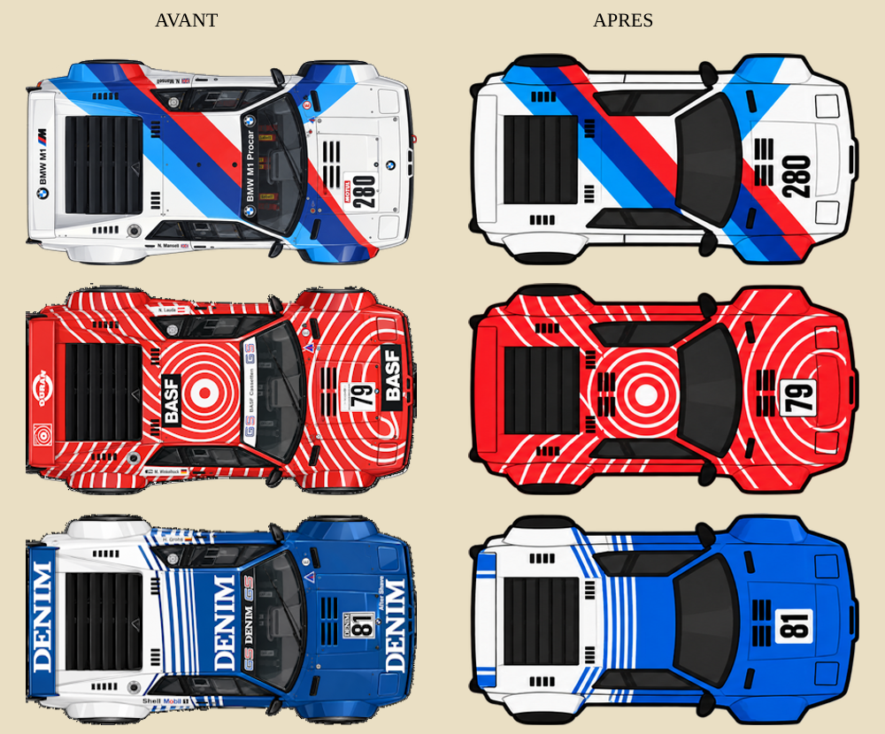

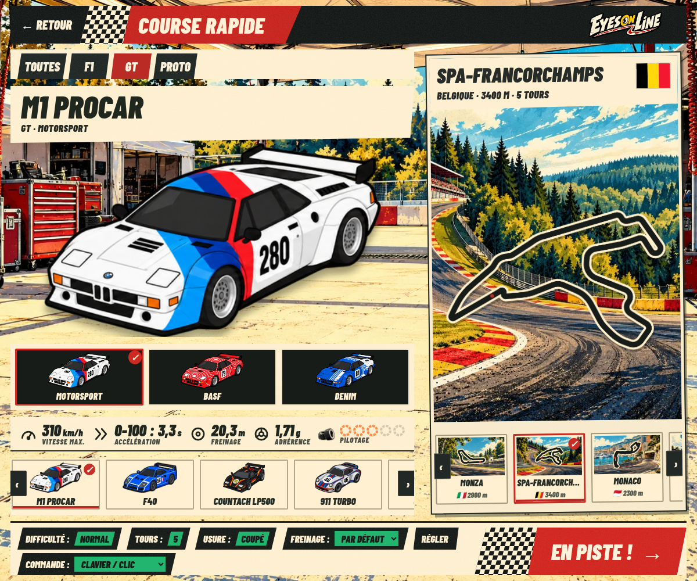

## Angle de la GT40

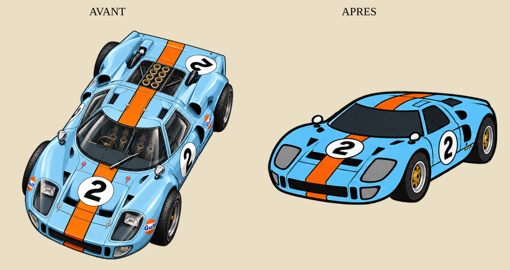

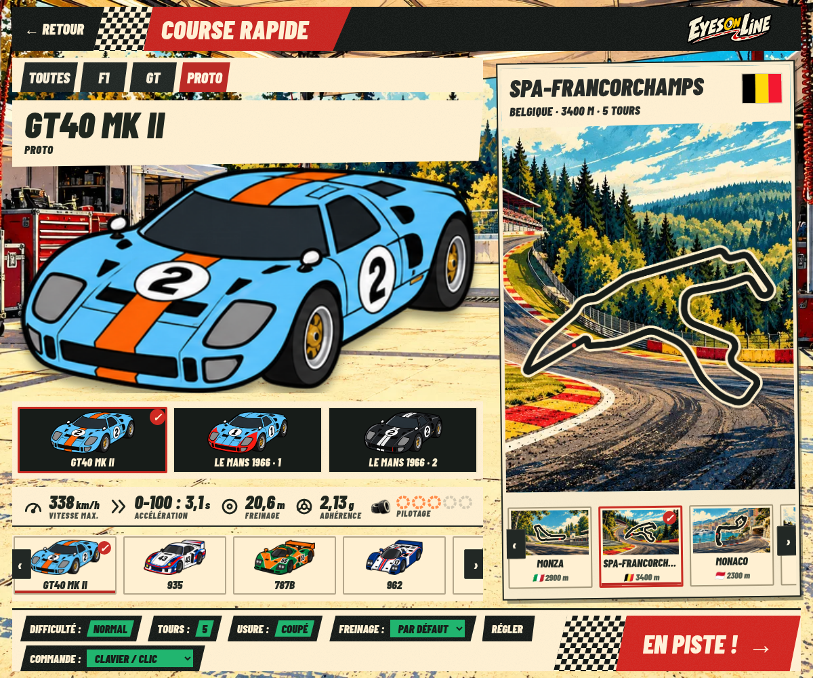

## Roues directrices

Le rendu utilise l'angle de direction de la physique, pour le joueur comme pour
les IA. Les pneus et leur ombre tournent sous la carrosserie. La Tyrrell P34 possède
deux essieux avant, soit quatre pneus directeurs.

En multi, le protocole 3 transmet le braquage aux voitures proches et aux
spectateurs : un octet supplémentaire par état détaillé (40 au lieu de 39).
Les états lointains restent à 14 octets. Les joueurs d'une table doivent utiliser
la même version ; le contrôle de compatibilité existant applique cette règle.

Les planches suivantes sont dessinées par le véritable moteur Canvas du jeu :
roues droites, braquage à droite, braquage à gauche, puis image du menu.

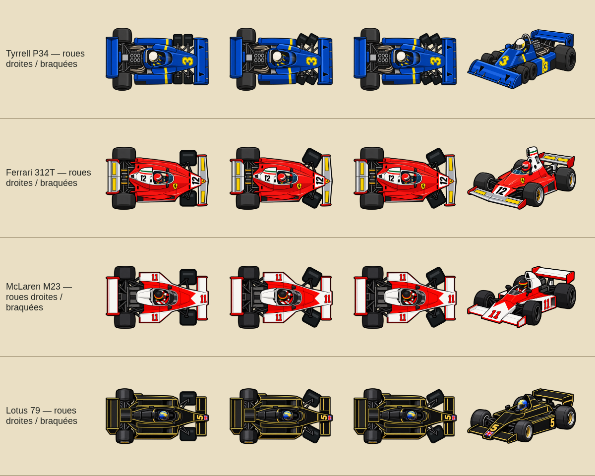
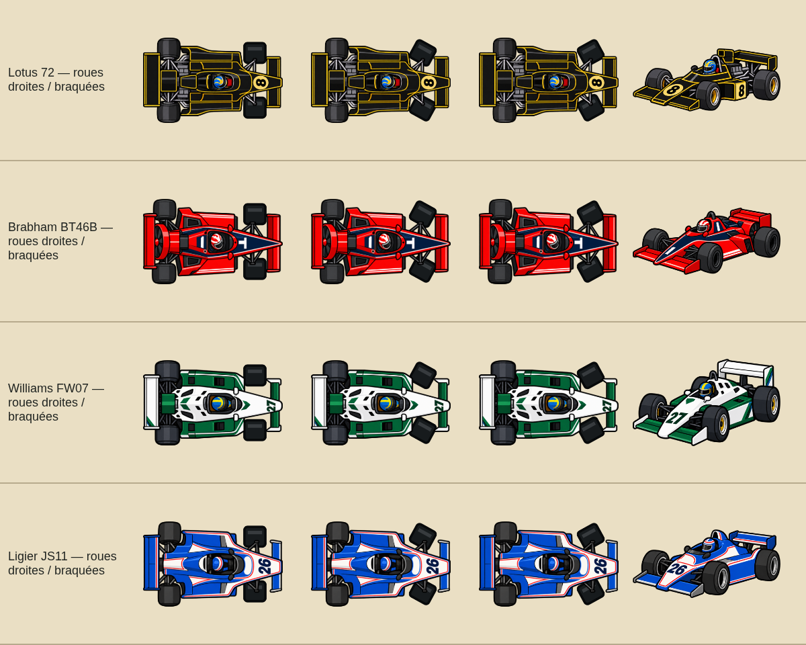
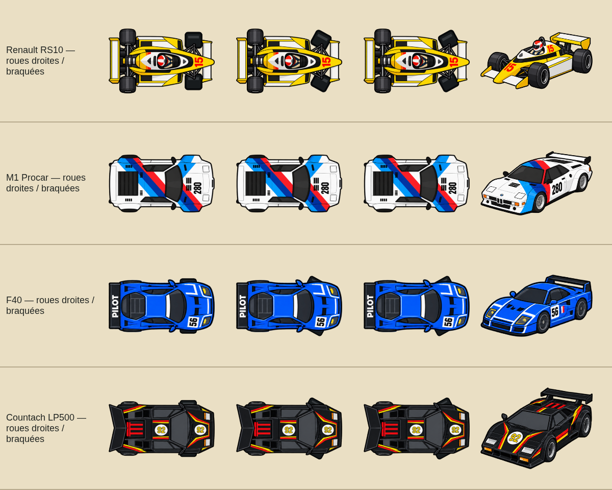
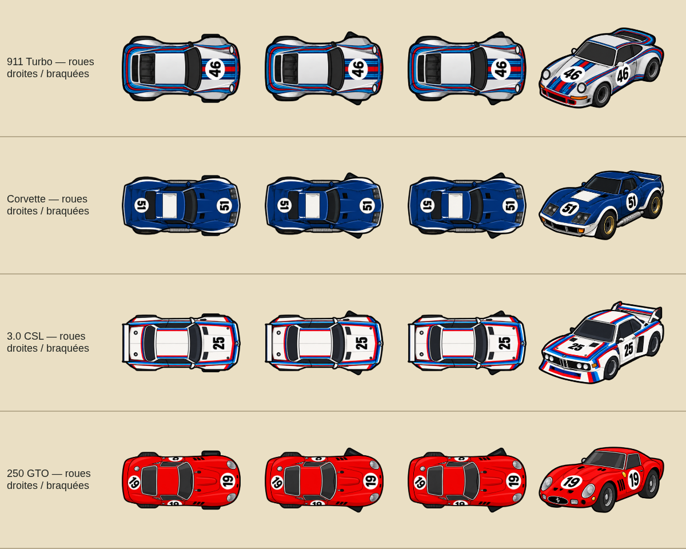
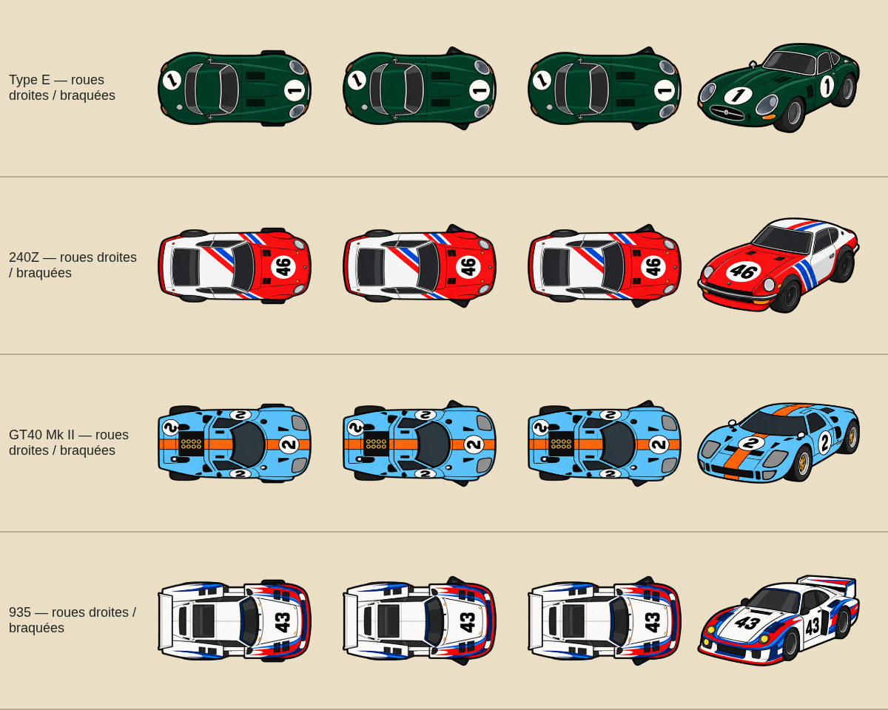
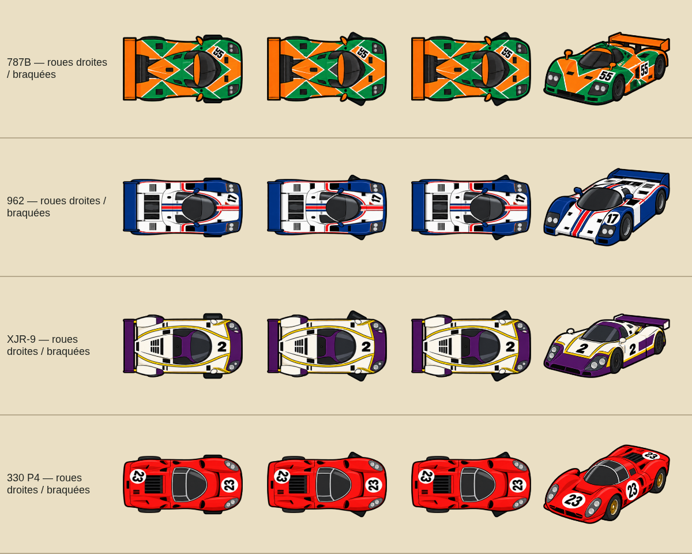
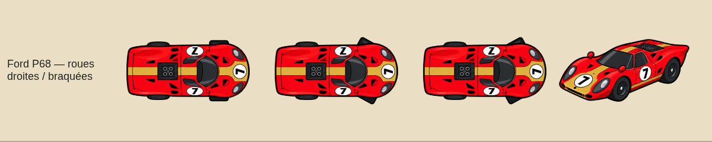

## Audit des modifications de Claude

Base examinée : `37cc909`, après la reprise des menus, du salon et des circuits.
Les tests confirment l'alignement des menus, le paddock sans défilement sur PC,
les sélections et la navigation tactile/clavier/manette, le HUD et les drapeaux.
Les circuits n'ont pas été modifiés par cette reprise des voitures.

Deux compléments d'interface :

- L'accélérateur tactile reçoit le fond noir et le contour beige du HUD, tout en
  conservant son indicateur central d'adhérence et son retour à l'appui.
- Un rafraîchissement de présence identique ne remplace plus tous les boutons
  du salon ; le ping est mis à jour séparément.

## Vérifications

- Dimensions des 57 PNG de course comparées à `37cc909` : toutes identiques.
  Les boîtes de collision et les paramètres physiques ne changent pas.
- `e2e-cartoon.js` : 57 livrées chargées, braquage visible dans les deux sens,
  ombres mobiles et nombre de pneus directeurs contrôlés.
- `e2e-menu.js` : six formats, français/anglais, navigation, sélections,
  absence de débordement et salon connecté.
- `e2e-pc.js` : clavier, souris, molette, gâchette, pause, rotation mobile/tablette.
- `e2e-manette.js` et `e2e-flags.js` : contrôle de la base de Claude.
- `net-owned-test.js` : codec du braquage, propriété locale de la physique,
  freinage, pertes, contacts et fin de course.
- `e2e-net.js` : deux joueurs, dix voitures en mouvement, aucune erreur navigateur.
  Les onglets sont activés avant les clics, comme lors d'une utilisation réelle.

Les parcours utilisent Chromium et des appareils/manettes simulés. Le transport
du test à deux joueurs est local ; il ne mesure pas une liaison Internet réelle.

## Règles pour les prochaines générations

Contour extérieur épais ; trois à cinq couleurs principales hors ombre ; un niveau
d'ombre ; pas de micro-texte ni de détails illisibles ; formes iconiques légèrement
exagérées. Conserver la silhouette et les ailes, les phares et les ailerons.
Seuls les pneus avant sont absents des vues de course. Les voitures des menus
restent complètes.

`tools/pack-cartoon.js modèle atlas.png` extrait les silhouettes complètes, sans
couper les voitures aux limites théoriques des cellules de l'atlas. Il conserve
les dimensions de course et le rapport de perspective des menus. Les JSON par
modèle recensent les dimensions et le nom de la génération source.
