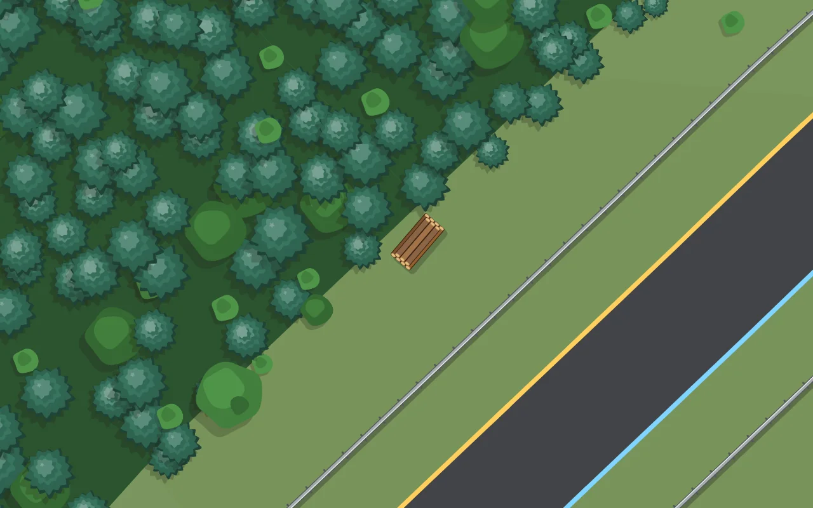
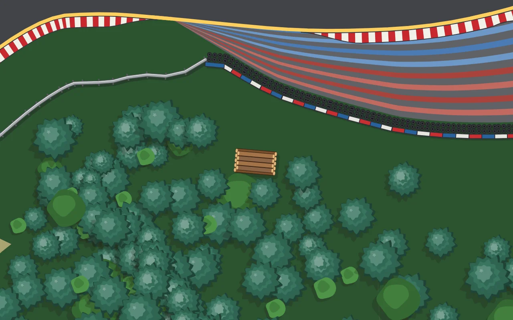
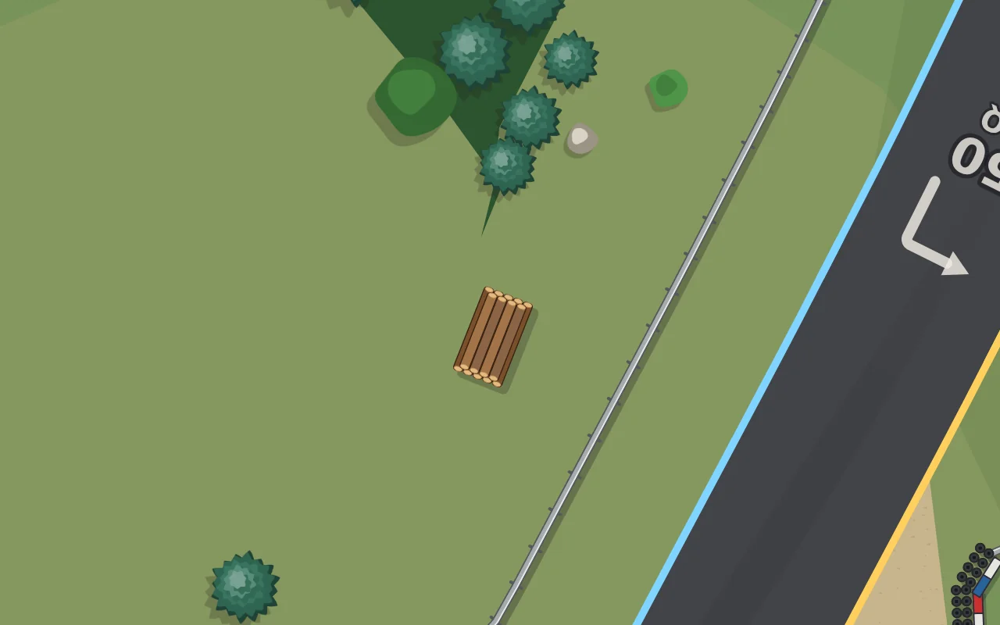

# Tas de bois — 0.41.5

Les tas de bois venaient du semis général et se peignaient après la forêt : on en voyait posés sur les couronnes, au milieu des bois. Ils obéissent maintenant à deux règles, et ne sont jamais au-dessus d'un arbre.

**En lisière, sous la canopée** (`implTasLisiere`, `js/props.js`) — une pile de grumes de temps en temps le long d'une vraie lisière de bois, sur une portion droite, au bord du bois côté piste : le dos de la pile passe sous les premières couronnes, l'avant reste dans l'herbe. Les troncs à moins de 3,6 m sont dégagés pour qu'elle ne disparaisse pas. Au plus huit par circuit.

**Seuls** (`tasIsoles`) — les tas du semis ordinaire ne sont gardés que s'ils sont isolés : aucune couronne d'arbre à moins de quatre mètres, à plus de 30 m de tout autre tas. Six au plus par circuit.

**Dessin** (`_drawTas`, `js/render.js`) — une pile vue du dessus, orientée comme la lisière qu'elle longe : un rang de grumes côte à côte, un second rang plus court dans les creux, les bouts sciés en clair aux deux extrémités, l'ombre portée en bas à droite. Elle se peint avant les arbres, si bien qu'une couronne passe toujours au-dessus d'elle.

Vérification : `tools/vehicules-banc.js` — aucun tas sur la piste, aucun sous un tronc, aucun tas collé à un autre, plus aucun tas dans le semis ; `decor-banc`, `decor-protections-banc`, `e2e-barrieres`.
