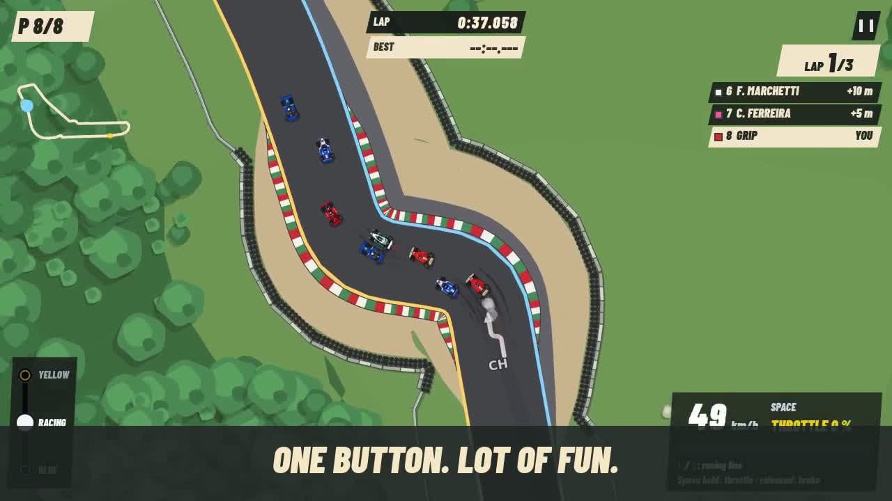

# GRIP — bande-annonce de 72 secondes

Deuxième version montée à partir du rendu réel du jeu, selon le script fourni. Les noms affichés sont ceux de la version actuelle du jeu.

- [Télécharger la vidéo avec musique](https://raw.githubusercontent.com/Brunodrapi/Slot_car_racing/refs/heads/claude/hybrid-racing-game-2d-jkk7q0/docs/trailer/grip-trailer.mp4)
- [Télécharger les prises pour un montage manuel](https://raw.githubusercontent.com/Brunodrapi/Slot_car_racing/refs/heads/claude/hybrid-racing-game-2d-jkk7q0/docs/trailer/rushes.zip)
- [Outil de capture et montage : installation et commandes](../../tools/trailer/README.md)
- [Script modifiable](../../tools/trailer/script.json)
- [Musiques proposées et crédits à conserver](MUSIQUES.md)

| Temps | Séquence |
|---|---|
| 00:00–00:05 | Peloton dans un virage — ONE BUTTON. LOT OF FUN. |
| 00:05–00:15 | Contre-la-montre dans les enchaînements — MASTER THE RACING LINE |
| 00:15–00:25 | Sortie, tête-à-queue, contacts — PUSH TOO HARD… AND YOU’LL PAY FOR IT. |
| 00:25–00:35 | Les 25 voitures dans leurs menus F1, GT et prototypes |
| 00:35–00:45 | Dézoom vers douze courses animées — 12 TRACKS. MULTIPLE CHALLENGES. |
| 00:45–00:57 | Caméras spectateur suivi, circuit entier, duel |
| 00:57–01:07 | Contre-la-montre, dépassement en course, passage de ligne et records mondiaux de Monza |
| 01:07–01:12 | Logo GRIP, PLAY NOW, crédit musical |

## Ce que contient cette version

1280 × 720, H.264, 24 images/seconde, musique AAC. Les douze cases de la mosaïque sont capturées à 12 images/seconde et assemblées à 24. Les interfaces sont en anglais, les textes du script sont conservés.

Les pilotes sont automatisés ; les positions/vitesses initiales des accidents sont préparées, puis la physique réelle tourne. Les caméras spectateur sont celles du jeu, mais la course est locale : ce n'est pas l'enregistrement d'une session Internet. Les 25 modèles sont montrés successivement dans leurs vrais menus (environ 0,4 seconde par modèle). Les passages de maîtrise sont capturés en contre-la-montre, avec une seule voiture. Un bref plan de course à deux voitures montre le dépassement. Les records mondiaux de Monza proviennent d’un instantané en lecture seule des données publiques, sans temps fictifs ; le tableau reprend les composants du jeu dans un cadrage agrandi. La caméra suit les voitures avec un cadrage de tournage.

Les titres et leur durée sont modifiables. La version fournie utilise « Brain Dance » de Kevin MacLeod, sous CC BY 4.0 ; le crédit apparaît au carton final et doit être conservé dans la description de publication. Aucun son moteur n'est enregistré dans cette version. Les coupes suivent le script temporel et ne sont pas toutes synchronisées sur les temps musicaux.

Le dossier local de sortie contient également le montage silencieux, les huit sections séparées et le rapport des captures. L'archive des prises conserve les images/MP4 sans titres, le script, les crédits et le rapport pour reprendre le montage dans un éditeur vidéo.

[Instantané des records de Monza utilisé pour le tournage](monza-records.json).
