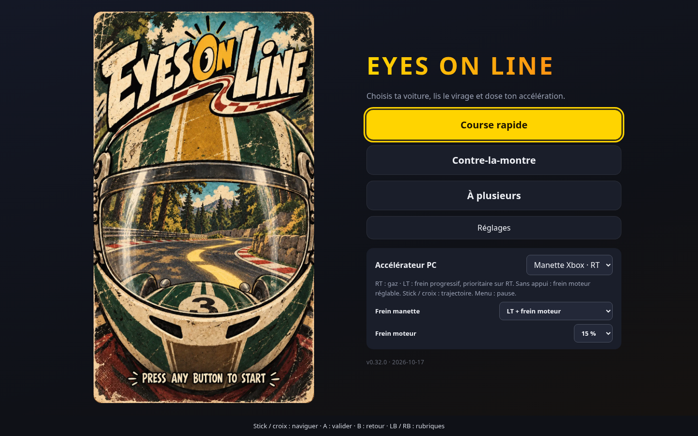
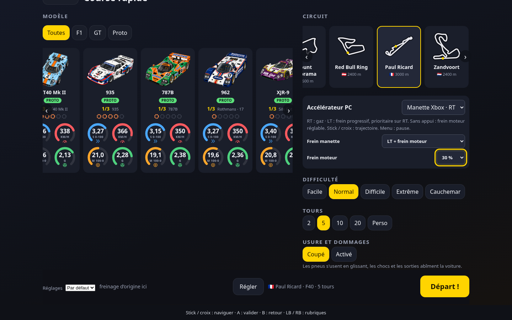
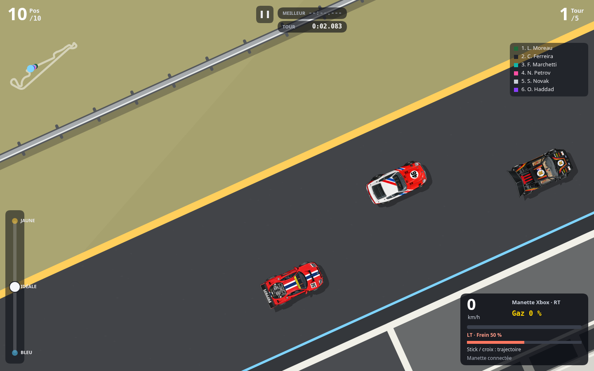
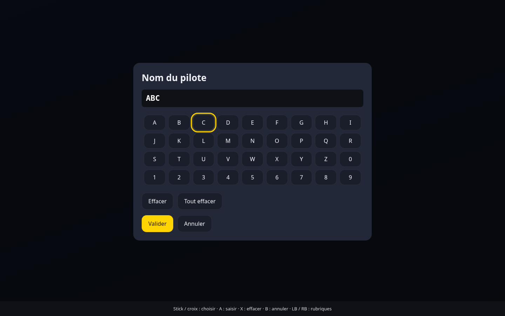
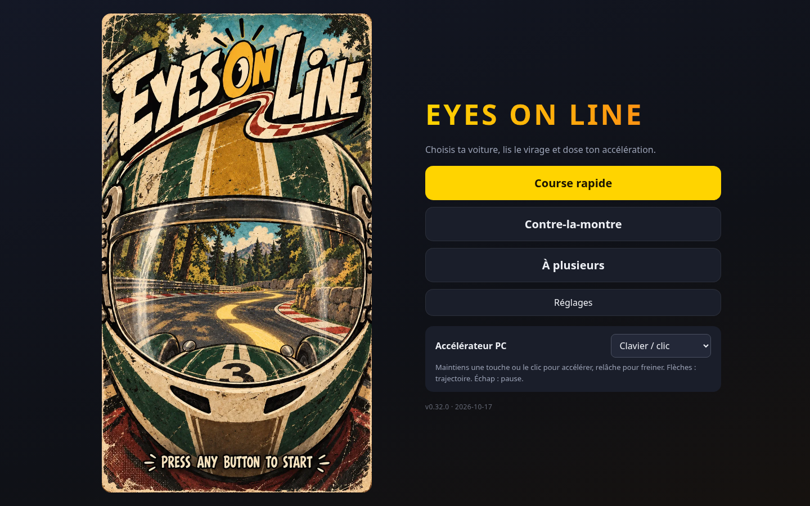
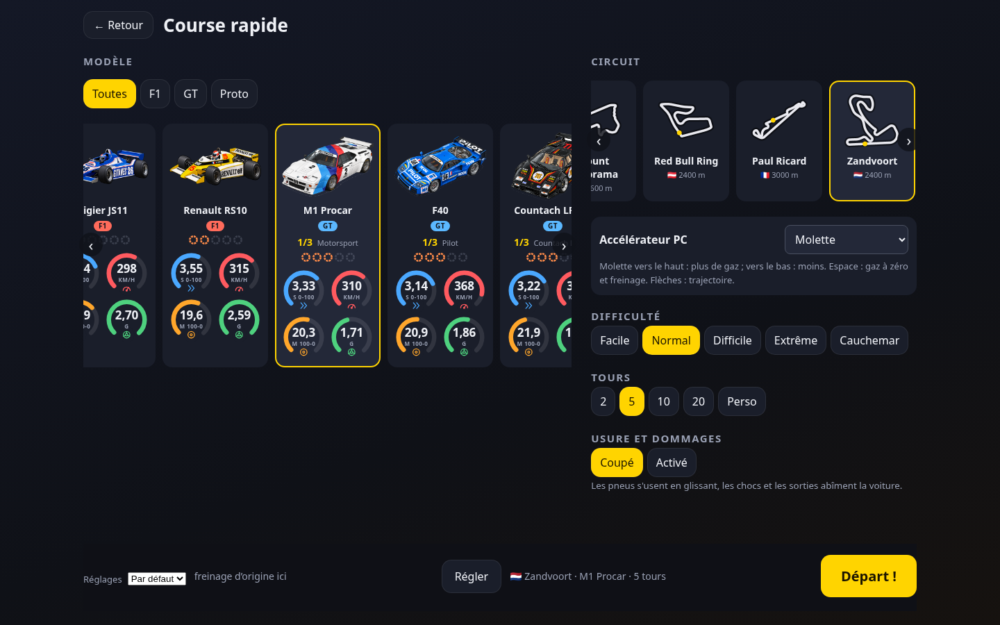
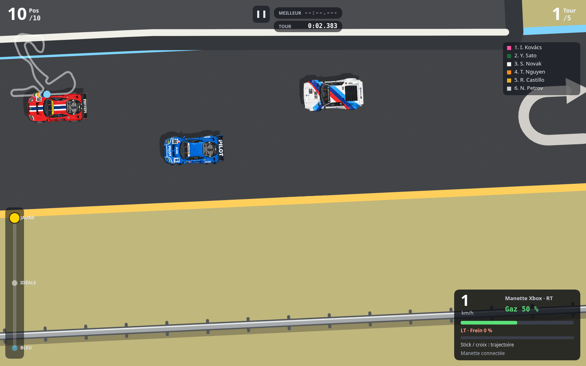
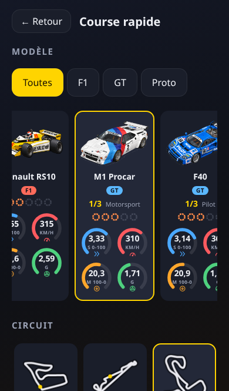
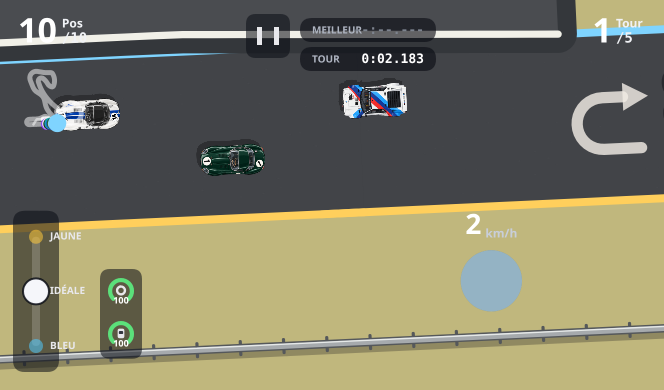

# Variante PC — 0.32.0

Le jeu choisit sa présentation suivant l'appareil. Sur PC, accueil en paysage, préparation avec
voitures à gauche et circuit/options à droite, réglages en deux colonnes. Sur mobile et tablette,
les menus conservent leur disposition portrait : même en tenant l'appareil en paysage, ils restent
en colonne, à la largeur du petit côté de l'écran. **La course seule utilise librement les deux
orientations**, sur toute la fenêtre. Aucun changement de circuit ou de modèle de voiture.

## Trois accélérateurs PC

Le sélecteur **Accélérateur PC** se trouve à l'accueil, avant le départ, dans les réglages et dans
la pause. Son choix est mémorisé localement ; le tactile mobile continue de fonctionner comme avant.
Une manette standard déjà branchée au démarrage ou détectée en cours de session est choisie
automatiquement. Un choix manuel différent reste respecté jusqu'à la prochaine connexion.

| Mode | Gaz et freinage | Choix de trajectoire |
| --- | --- | --- |
| Clavier / clic | Maintenir pour le plein gaz, relâcher pour freiner. Les pulsations entre deux images sont conservées. | Flèches, molette ou levier à l'écran. |
| Molette | Vers le haut pour augmenter, vers le bas pour réduire. La valeur reste au niveau choisi. Espace ramène à zéro et déclenche le freinage existant. | Flèches ou levier. |
| Xbox | RT : gaz ; LT : frein progressif. Sans appui : frein moteur réglable. | Stick gauche, croix, flèches ou levier. |

## Menus à la manette

Stick/croix : déplacer le focus jaune. A : valider. B : retour ou annulation, et reprise depuis la
pause. LB/RB : rubrique précédente/suivante (filtres, voitures, circuits, commandes, options…). Les
listes de voitures et de circuits défilent pour garder l'élément visé visible, y compris leurs cartes
initialement cachées. Le focus est conservé après choix de voiture, changement de livrée ou réglage.

Les sélecteurs se règlent avec gauche/droite, ou A pour ouvrir leur liste dans le jeu. A sur un
champ de texte ouvre le clavier à l'écran, navigable avec les mêmes commandes ; X y efface un
caractère. Cela couvre notamment le premier pseudo, le code de salon et les noms de configurations.
Les confirmations existantes disposent aussi de boutons accessibles à la manette. Les boutons A/B
ne se répètent pas lorsqu'on les maintient ; les directions ont une répétition lente et le stick
une hystérésis. Après passage en arrière-plan, relâcher les boutons évite de valider un écran au retour.

## Frein LT et frein moteur

Le mode **LT + frein moteur** est proposé par défaut à la manette. RT commande la poussée, LT le
freinage ; LT est prioritaire si les deux gâchettes sont enfoncées. Sans aucune gâchette, le moteur
ralentit la voiture à l'intensité choisie dans **Frein moteur** : 15 % par défaut, réglable de 0 à
100 % de la puissance de freinage du modèle. À 0 %, seules les pertes naturelles subsistent.

LT augmente progressivement le freinage restant jusqu'au maximum du réglage circuit/voiture.
Le frein moteur ne déclenche pas les feux de freinage ; LT les déclenche. LT continue de fonctionner
lors d'une coupure moteur après un choc. Le HUD indique séparément les gaz et le frein LT en pourcentage.
Le mode **Automatique au relâchement** garde aussi le freinage historique avec RT seule. Les réglages
de mode et de frein moteur sont enregistrés sur le navigateur.

Avec la manette, un mouvement du stick fait passer d'un cran de trajectoire ; le recentrer permet
le mouvement suivant. La croix haut/droite va vers le jaune, bas/gauche vers le bleu, comme les
flèches. Ce sont des changements de ligne de slot racing, pas un volant. Le bouton Menu met en
pause/reprend ; Échap et P fonctionnent aussi. Un léger mouvement parasite des gâchettes est ignoré
(zone morte de 5 %). Appuyer une fois sur un bouton peut être nécessaire pour que le navigateur
expose la manette. Mapping standard de la Gamepad API, sur HTTPS ou localhost.

Le HUD PC remplace la pastille tactile par la vitesse, le mode actif et une barre **Gaz 0–100 %**.
Les commandes analogiques modulent la poussée demandée et l'entrée du moteur sonore. Le plein gaz
et le lever de pied du clavier/tactile gardent exactement la physique précédente ; les réglages de
freinage et de motricité s'appliquent aussi au dosage partiel. Le réseau transmet les fractions de
gaz, la demande de frein LT et le réglage de frein moteur à l'hôte. Le codec des instantanés conserve
ses drapeaux existants : la priorité du frein empêche de confondre gaz+frein avec une coupure moteur.

Chaque départ, changement de mode ou pause remet les gaz à zéro. La perte de focus met en pause,
ainsi qu'une déconnexion de la manette en course. À la connexion et après reprise, RT doit être
relâchée avant d'accélérer. La pause indique l'état de connexion et permet de changer de commande.
Le stick a une hystérésis pour éviter plusieurs crans dus à un tremblement autour du seuil.

## Captures du jeu

Manette détectée, menus et réglage des gâchettes :

Accueil PC :

Préparation PC :

Course PC, dosage à la molette :

Course PC, gâchette à mi-course dans la manette simulée :

Menu mobile portrait et course mobile paysage :

## Vérifications

| Vérification | Résultat |
| --- | --- |
| `node tools/pc-controls-test.js` | 25 voitures : clavier inchangé, poussée sur cinq niveaux, frein moteur réglable, LT progressif/prioritaire même moteur coupé ; Race et messages réseau. 100 simulations de quatre secondes sur Monaco/Spa/Monza/Zandvoort : états finis. |
| `node tools/e2e-manette.js /tmp/manette` | Parcours sans clic : détection automatique, boutons maintenus, navigation, rails, livrées, listes, RT/LT, pause/B, choix manuel, reconnexion, sauvegarde, saisie du premier pseudo, annulation et changement de langue. Aucune erreur JS. |
| `node tools/pulsations-entree.js` | Appuis de 50, 100 et 150 ms conservés à 15, 30 et 60 images/s ; remise à zéro en pause. |
| `node tools/e2e-pc.js /tmp/pc-captures` | Parcours navigateur PC 1440×900, iPhone 13 et iPad : sélection, sauvegarde, trois commandes, dosage reçu par la voiture, perte de focus, pause/reprise/déconnexion, rotation tactile et retour portrait. Aucune erreur JS. |
| `node tools/caracteres-f1-test.js` | Courbes/profils des 23 voitures hors Brabham/Renault et freinage des 25 modèles inchangés ; caractères BT46B/RS10 conservés. |
| `node tools/e2e-f1.js /tmp --cars=renaultrs10` | Sélection, sauvegarde, sprite et simulations sur Monaco, Spa, Monza et Zandvoort. |
| `node tools/e2e-menu.js /tmp` | Menu-affiche mobile, zones des bandeaux, navigation et défilement conservés. |
| `node tools/e2e-categories.js /tmp` | Filtres, migrations, grilles et salon à deux écrans : aucune faute. |
| `node tools/e2e-duo.js 3 --joueurs=2 --frein-manette` | Hôte/invité, mouvement réseau, LT à 37,5 %, frein moteur à 30 %, priorité sur RT et retour au mode automatique. Transport remplacé par BroadcastChannel pour ce test. |

Les tests navigateur utilisent Chromium. Les valeurs et boutons Xbox sont **simulés dans la
Gamepad API** ; aucune manette physique n'était raccordée à l'environnement cloud. Le branchement
USB/Bluetooth et la sensation de gâchette restent à vérifier sur le matériel du joueur.
