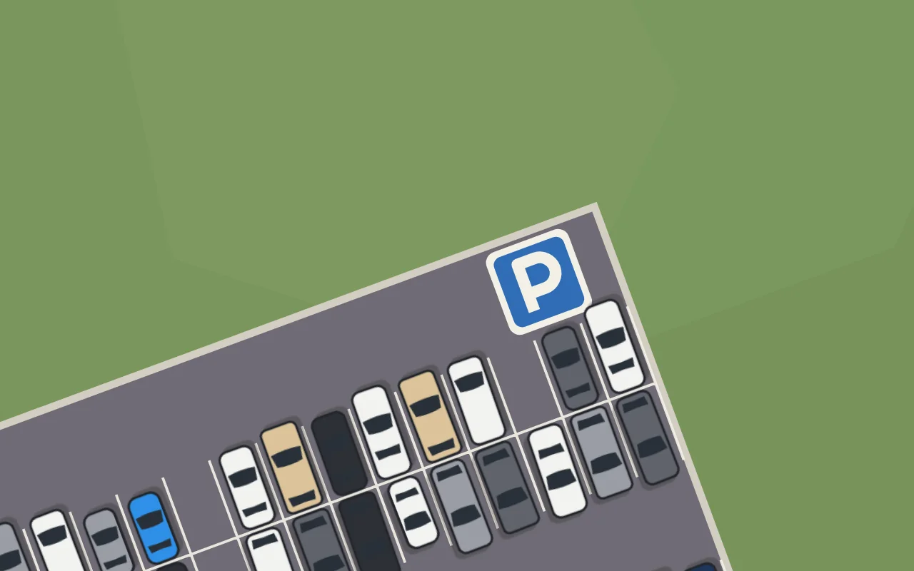
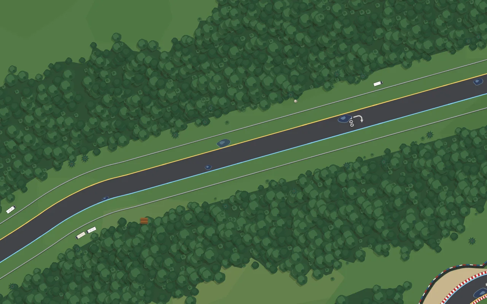

# Véhicules du décor — 0.41.3

Les voitures des parkings étaient des rectangles gris. Elles suivent maintenant la planche de référence fournie : vue de dessus, aplat franc, contour épais et sombre, vitres presque noires.

**Quatorze gabarits** (`VEHICULES`, `js/props.js`), aux dimensions réelles en mètres : citadine, compacte, berline, break, SUV, taxi (enseigne de toit), fourgonnette, pick-up (benne sombre), minibus, utilitaire et camping-car (cabine plus étroite que la caisse, lanterneaux), bus, semi-remorque (tracteur et remorque) et moto. Chaque gabarit a plusieurs teintes ; la plupart des voitures restent blanches, grises ou noires, avec une couleur franche de temps en temps, pour qu'un parking ne devienne pas une boîte de bonbons. Une vignette par gabarit et par teinte est cuite une fois, ombre comprise : un parking de plusieurs centaines de véhicules coûte un `drawImage` tourné par véhicule.

**Parkings — 0.41.3.** Un parking est maintenant un vrai parc de stationnement, reconnaissable d'en haut : un enrobé rectangulaire bordé d'une bordure claire, découpé en bandes (une allée, deux rangées de places dos à dos, une allée…), avec les places peintes en blanc, occupées ou non, et un panneau P bleu dans l'allée côté piste. Les rangées restent parallèles entre elles même le long d'un virage ; les colonnes de places qui toucheraient la piste ou ses protections sont retirées, enrobé compris. Chaque voiture regarde son allée et se gare contre la ligne médiane ; une moto prend une place à deux ou trois ; la dernière bande des parcs de deux bandes ou plus reçoit les grands gabarits garés en long (camping-cars, utilitaires, minibus, pick-up, cars, semi-remorques). Aucun arbre ne pousse sur l'enrobé.

**Camping-cars en bord de piste — 0.41.3.** Juste quelques-uns : des groupes d'un à trois véhicules garés en long derrière la protection, espacés de plus de cent mètres, au plus deux par zone et cinq par circuit (17 en tout sur les treize circuits). Les zones `camping` sont posées sur Le Mans, Spa, le Nürburgring, Mount Panorama, Silverstone, le Red Bull Ring, Zandvoort, Laguna Seca et le Paul Ricard ; un groupe ne s'installe ni dans un virage serré ni trop près d'une autre portion de piste, si bien qu'un circuit sinueux peut n'en avoir aucun.

Vérification : `tools/vehicules-banc.js` — aucun véhicule sur la piste, sur une protection ou un bâtiment, aucun camping-car superposé, au plus cinq camping-cars par circuit, chaque parc avec ses places peintes et son panneau, les quatorze gabarits posés au moins une fois ; `decor-banc`, `decor-protections-banc`.
