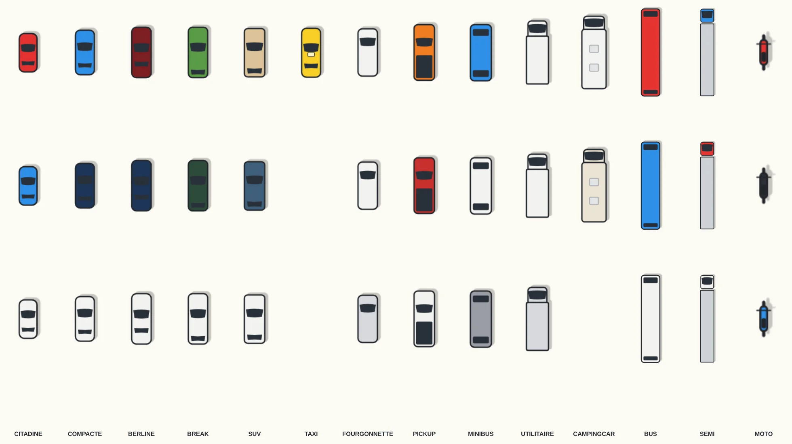
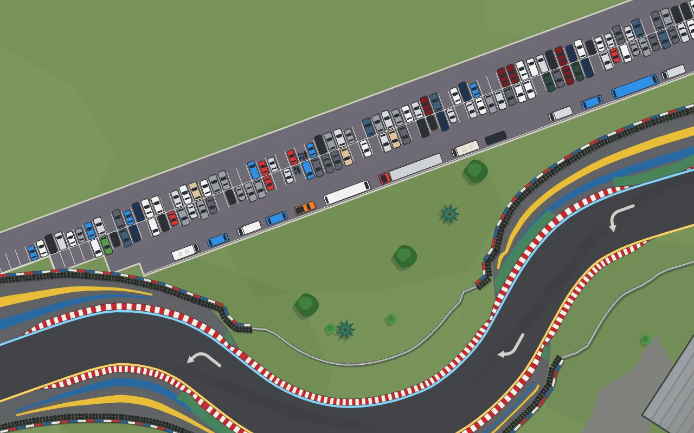
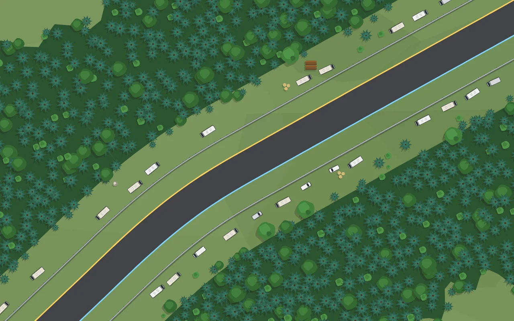

# Véhicules du décor — 0.41.2

Les voitures des parkings étaient des rectangles gris. Elles suivent maintenant la planche de référence fournie : vue de dessus, aplat franc, contour épais et sombre, vitres presque noires.

**Quatorze gabarits** (`VEHICULES`, `js/props.js`), aux dimensions réelles en mètres : citadine, compacte, berline, break, SUV, taxi (enseigne de toit), fourgonnette, pick-up (benne sombre), minibus, utilitaire et camping-car (cabine plus étroite que la caisse, lanterneaux), bus, semi-remorque (tracteur et remorque) et moto. Chaque gabarit a plusieurs teintes ; la plupart des voitures restent blanches, grises ou noires, avec une couleur franche de temps en temps, pour qu'un parking ne devienne pas une boîte de bonbons. Une vignette par gabarit et par teinte est cuite une fois, ombre comprise : un parking de plusieurs centaines de véhicules coûte un `drawImage` tourné par véhicule.

**Parkings.** Chaque voiture regarde son allée et les deux voitures dos à dos alignent leurs pare-chocs arrière ; une moto prend une place à deux ou trois. Ce qui ne tient pas dans une place — camping-cars, utilitaires, minibus, pick-up, cars, semi-remorques — se gare en long sur la dernière rangée des parkings assez profonds.

**Camping-cars en bord de piste.** Une zone d'implantation `camping` pose une file irrégulière de camping-cars et de fourgons garés en long derrière la protection, avec des trous, hors des virages serrés et loin de toute autre portion de piste. Neuf circuits en ont : Le Mans (Hunaudières), Spa (Kemmel), Nürburgring, Mount Panorama, Silverstone, Red Bull Ring, Zandvoort, Laguna Seca et le Paul Ricard. Aucun arbre ne pousse sur un véhicule.

Vérification : `tools/vehicules-banc.js` — aucun véhicule sur la piste, sur une protection ou un bâtiment, aucun camping-car superposé, les quatorze gabarits posés au moins une fois ; `decor-banc`, `decor-protections-banc`.
